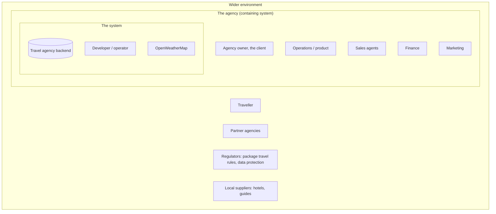

# 00 Domain: stakeholders, actors, language

Status: draft, 2026-10-26. Written before the architecture, because the brief names only "the
client" and "the agency"; everyone else who touches or depends on the system is defined here.

## 1. Stakeholder map (onion)

## 2. Stakeholders (arc42 1.3)

| Role | Channel | Expectations | Actor |
|---|---|---|---|
| Agency owner ("the client" in the brief) | commissions the work, reads reports | A system that runs the agency: catalogue, dates, capacity, weather for sales; reliable and cheap to operate | no |
| Operations / product | admin and API, daily | Manage locations, destinations, packages, departures and capacity without developer help; see what is sold out | yes: `ops` |
| Sales agents | API via the agency's front end | Find bookable packages for a traveller's dates and risk appetite; book without overbooking; cancel | yes: `sales` |
| Finance | read access | Bookings and prices per departure, exportable | yes: `finance` |
| Marketing | read access, weather data | Which destinations are warm this week; weather driven offers | reads through `finance` or `ops` |
| Partner agencies | API with their own token | Search and book on behalf of their travellers; stable contract, documented | yes: `partner` |
| Traveller | through the agency or a partner, never the API | A tour that fits dates and risk appetite; a confirmed seat; personal data handled lawfully | no (data subject; self-service in the roadmap) |
| Regulators | none, indirect | EU package travel rules (price transparency, cancellation rights), GDPR for traveller data | no |
| Local suppliers | none in this iteration | Capacity per departure reflects what they can deliver | no |
| Developer / operator | repo, cluster | One command locally, one pipeline to deploy, visible health, documented decisions | yes: operates |
| OpenWeatherMap | HTTPS, API key | Stay inside the free tier's limits | external system |

## 3. Jobs to be done, per actor

- **Operations:** "When a supplier confirms a new date, I add a departure with its capacity, so
  sales can sell it the same day." "When a trail is closed, I raise the destination's danger
  and every package containing it reflects it at once." "Each morning I see which departures
  in the next 30 days are sold out or nearly sold out."
- **Sales:** "When a traveller says 'first half of March, nothing too risky', I get the
  packages that depart in that window with danger at most medium and seats left." "When two of
  us sell the last seat at the same time, only one booking goes through." "When a traveller
  cancels, the seat is free again and the record stays."
- **Partner:** "I integrate once against a documented API and the contract does not change
  under me." "My bookings are mine; I never see another partner's."
- **Finance:** "At month end I list confirmed bookings with price and departure."
- **Marketing:** "This week I want the destinations above 25 °C to build an offer."
- **Operator:** "A bad deploy rolls back in one command; a lost server is rebuilt from code
  and the last backup."

Each job maps to an endpoint in [04-api.md](04-api.md) or to an extra feature; extras are
proposed only where a job above asks for them.

## 4. Ubiquitous language

| Term | Meaning here | Not to be confused with |
|---|---|---|
| Client | The agency owner, who commissioned the system (the brief's usage) | API clients, travellers |
| Traveller | The person who takes the tour; a record, not a user of the API | "customer", avoided as ambiguous |
| Location | A place on the map with coordinates and a time zone; the weather is read for it | destination |
| Destination | A sellable experience at a location, with a type and a danger score | location |
| Package | A named, priced tour composed of destinations, with a duration | departure |
| Departure | One package on one start date with its capacity; the unit that is sold | package |
| Booking | Seats reserved on a departure for a traveller | enquiry |
| Danger score | 0 none, 1 low, 2 medium, 3 high; a package's score is the max of its destinations | risk appetite |
| Risk appetite | The highest danger a traveller accepts, on the same scale | danger score |
| Bracket | A temperature range used to group locations | forecast day |
| Bookable | Departure in the requested range, in the future, with seats remaining | active |

## 5. Roles and permissions

| Action | ops | sales | partner | finance |
|---|---|---|---|---|
| Read weather, brackets, locations, catalogue, departures | yes | yes | yes | yes |
| Create, update, delete locations, destinations, packages, departures | yes | no | no | no |
| Trigger a weather refresh | yes | no | no | no |
| Create a booking | yes | yes | yes (own travellers) | no |
| Cancel a booking | yes | yes | yes (own) | no |
| Read bookings | all | all | own only | all |
| Django admin | yes | no | no | no |

Tokens identify a user; a user belongs to one role. A partner token is scoped to that
partner's bookings. The traveller has no token in this iteration (see 07-roadmap.md,
self-service).

## 6. Domain events

Named now, published later (ADR 0008): `DepartureCreated`, `DepartureSoldOut`,
`BookingConfirmed`, `BookingCancelled`, `DestinationDangerChanged`, `WeatherRefreshed`.

## 7. Questions I would ask the client first

| Question | Working assumption until answered |
|---|---|
| Who uses the system day to day, and do travellers book themselves? | Staff and partners; travellers through them (A8) |
| How many packages, departures and bookings per year? | Hundreds of departures, thousands of bookings: PostgreSQL without partitioning |
| How fresh must weather be for sales conversations? | 15 minutes for known locations (ADR 0005) |
| "Between two dates": the departure, or the whole trip? | The departure (ADR 0011) |
| "For a given danger score": exactly, or at most? | At most, exact as a flag (ADR 0003) |
| Cancellation and refund rules? | Cancellation frees the seat; refunds out of scope |
| Which currencies? | One per package, EUR default (A7) |
| Do partners need their own prices or quotas? | No; same catalogue, own bookings |
