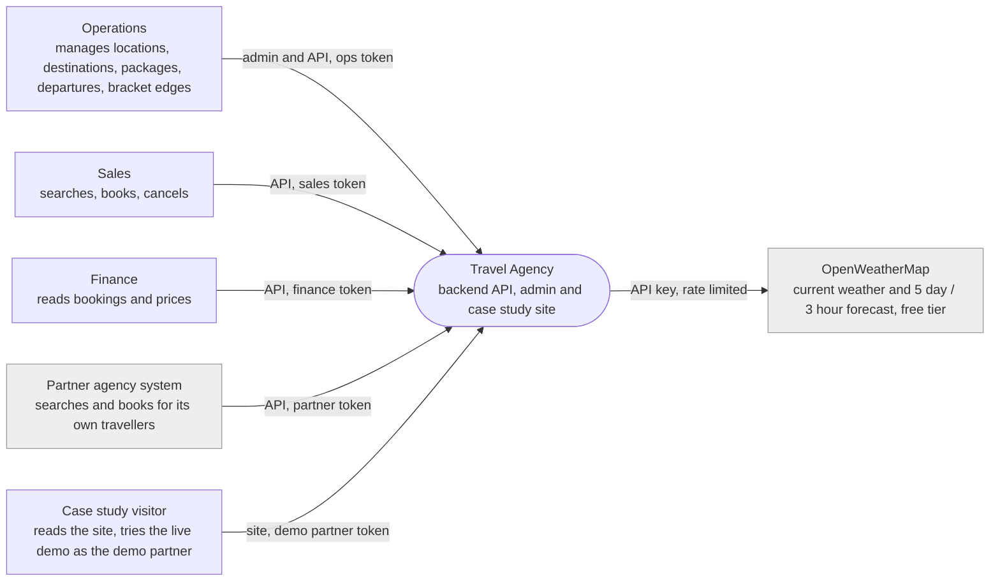
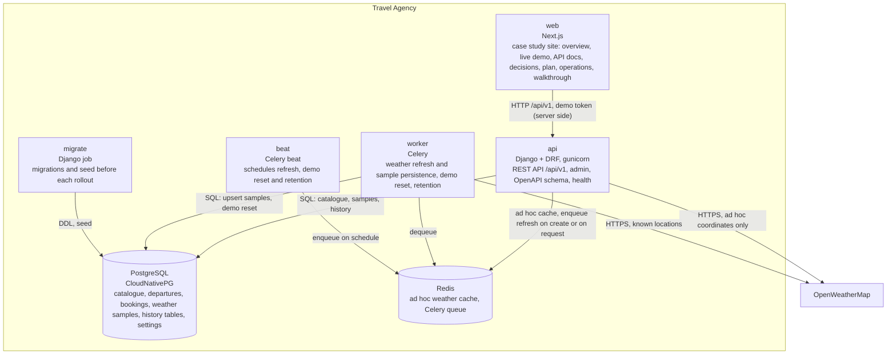
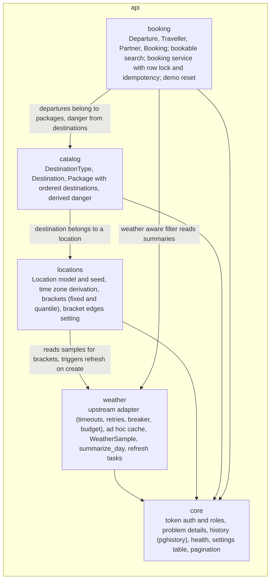
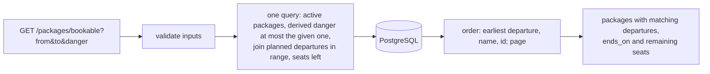
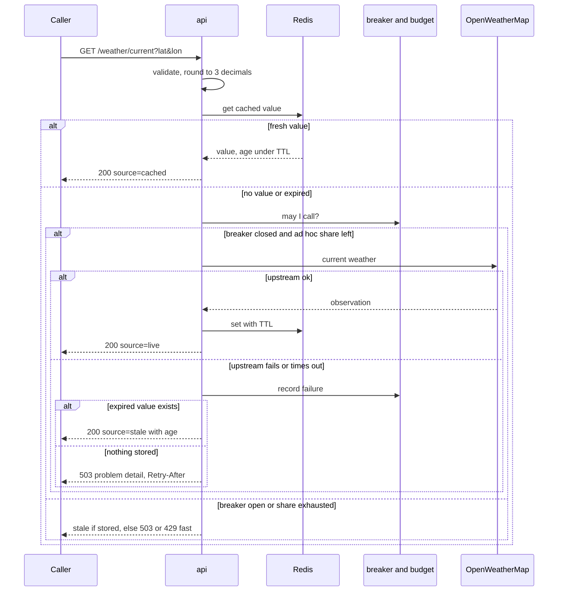
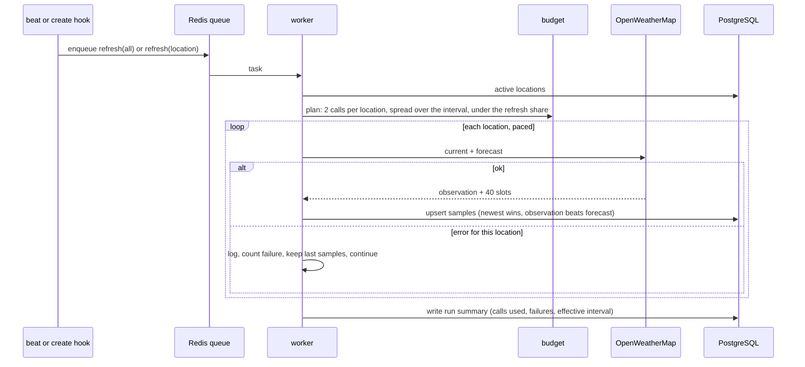
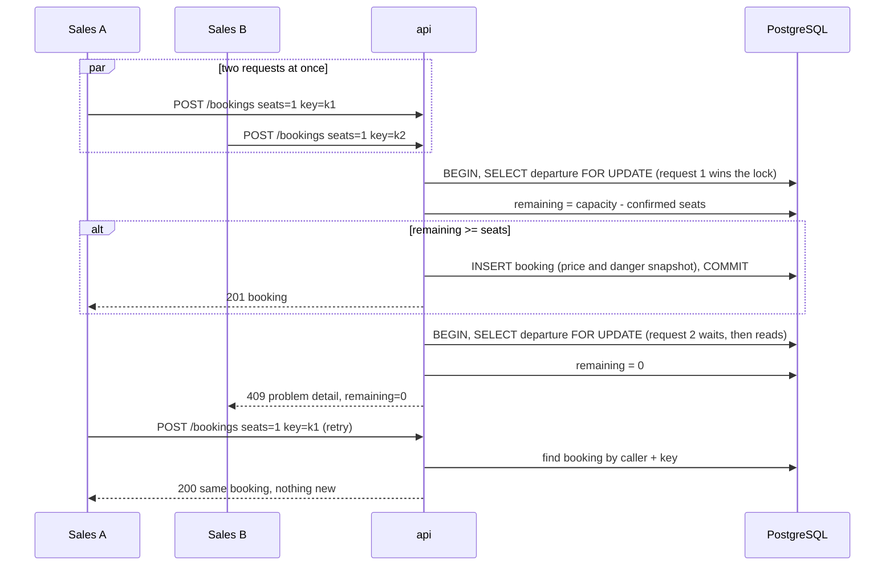
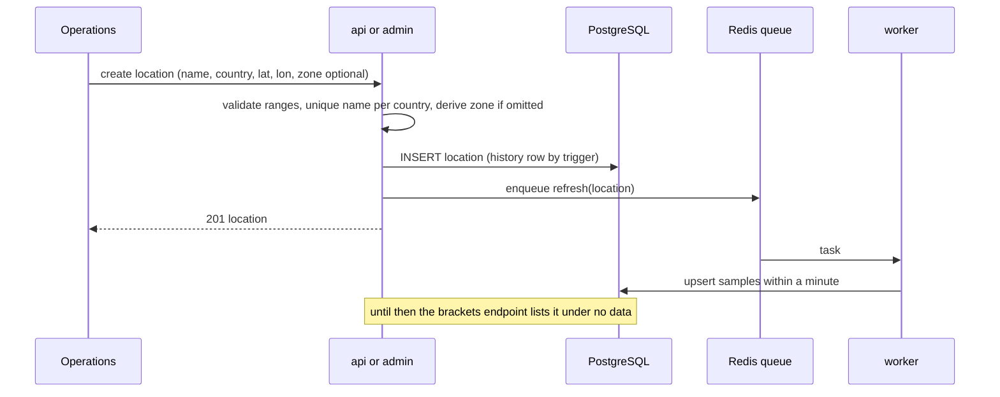
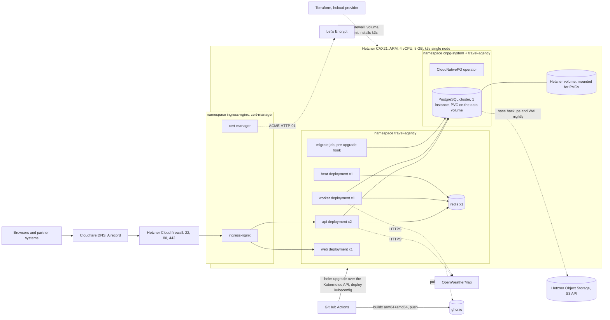
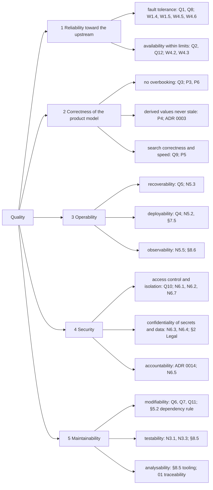

# 02 Architecture

Status: draft, 2026-10-26. Structure follows arc42 (docs.arc42.org), subsection by
subsection; diagrams follow C4. Open items are marked `TODO` and tracked in [arc42-checklist.md](arc42-checklist.md).

## 0. Summary (one page)

**What it does, and for whom.** A backend for a travel agency: live weather for coordinates
and for the agency's locations, those locations grouped by temperature bracket, and a product
catalogue of packages, destinations and dated departures with capacity, searchable by date
range and danger score, with bookings that never oversell. Operations manage the catalogue,
sales and partner agencies search and book, finance reads; travellers are served through them
and never call the API (00-domain). It runs as a Django + DRF API with Celery workers,
PostgreSQL and Redis, packaged as one Helm chart on Kubernetes, with a Next.js case study
site in front. Requirements and the seventeen assumptions that close the brief's gaps are in
01-requirements.

**Structure.** Four Django apps behind one API: `weather` (upstream adapter, samples, daily
summaries), `locations` (list, seed, brackets), `catalog` (destinations, packages),
`booking` (departures, bookings, the bookable search); `core` carries token auth with the
four roles, problem-detail errors, trigger-based change history and health. A worker and a
scheduler sit beside the API; the container diagram is in §5.1.

**Two data flows.** Weather comes in on a schedule: the worker fetches every known location
from OpenWeatherMap (and a new location at once), upserts the slots and observations into
PostgreSQL, and the API computes daily summaries from there; ad hoc coordinates are fetched
on request and cached briefly in Redis. The bookable search goes out from one query: active
packages whose derived danger fits, joined to planned departures in the date range with seats
left, ordered and paged, each with its end date and remaining seats (§6).

**Three main decisions.** The departure (package + date + capacity) is the sellable unit, and
a booking takes a row lock on it, so two sales of the last seat cannot both succeed (ADR 0002;
the alternative, capacity on the package, could not express a sold out date). The package's
danger is derived in the query from its destinations, never stored, so a changed trail is
reflected at once (ADR 0003; a stored column is the documented next step if measured cost
asks for it). Known locations are never fetched on the request path: a scheduled job writes to
PostgreSQL inside the upstream's budget and the API reads from there, with stale fallback and
a circuit breaker (ADR 0005, 0012; the alternative, calling upstream per request, breaks under
the free tier's limits and outages).

**Quality order and limits.** Reliability toward the upstream first, then correctness of
capacity and danger, then operability, then maintainability (§1.2). One server, no high
availability, no event streaming, no payments or traveller self-service in this iteration;
each is in 07-roadmap with what it would take.

**Stack and why.**

| Element | Role | Decision |
|---|---|---|
| Python, Django, DRF | API, admin for operations, ORM, migrations, OpenAPI | ADR 0001 |
| Celery (+ beat) | Scheduled and on-create weather refresh | ADR 0005 |
| PostgreSQL (CloudNativePG) | Catalogue, departures, bookings, weather samples, history tables | ADR 0007, 0012, 0014 |
| Redis | Ad hoc weather cache, Celery broker | ADR 0005 |
| OpenWeatherMap, free tier | Current weather and 3 hour forecast slots; the only external data source | F1 to F3 |
| Helm on k3s (Hetzner ARM), Terraform, ingress-nginx, cert-manager | One chart, values per environment including an Azure (AKS) profile; HTTPS | ADR 0006, 0009 |
| Next.js | Case study site: demo, docs, operations, walkthrough | 05-work-packages W |

Everything below is the long form (arc42); decisions are in [adr/](adr/README.md).

## 1. Introduction and goals

### 1.1 Requirements overview

A travel agency backend: weather for coordinates and for the agency's locations (grouped by
temperature bracket), and the product catalogue (packages, destinations, dated departures with
capacity) with a bookable-packages search by date range and danger score, plus bookings that
never oversell.

Driving forces (00-domain): the agency owner wants to run the agency without developer help
for everyday changes; sales wants to answer "these dates, nothing too risky" in one query and
book without double selling; marketing wants weather it can sell with; partner agencies want a
contract they can integrate against once.

Requirements and their acceptance checks are in [01-requirements.md](01-requirements.md):
W1 to W4 weather, L1 to L4 locations and brackets, P1 to P6 catalogue, departures and booking,
N1 to N6 qualities, F1 to F5 facts about the environment, A1 to A16 assumptions that close
the brief's gaps.

### 1.2 Quality goals

Top goals in priority order, named after ISO 25010 characteristics, each with what measures
it (quality scenarios in §10.2, requirements in 01).

| # | Goal | ISO 25010 | Meaning here | Measured by |
|---|---|---|---|---|
| 1 | Reliability toward the upstream | reliability: fault tolerance, availability | Answers even when OpenWeatherMap is slow, down or rate limiting; its budget is never exceeded | Q1, Q2; W1.4, W1.5, W4 |
| 2 | Correctness of the product model | functional suitability: correctness | Capacity, availability and danger are never ambiguous or stale | Q3; P3, P4, P5, P6 |
| 3 | Operability: deploy, recover, observe | reliability: recoverability; maintainability: modifiability | One command locally, one pipeline to deploy, rollback in one command, restorable from backup, visible health and budget | Q4, Q5; N5 |
| 4 | Security | security: confidentiality, integrity, accountability | Token per user with four roles, partners see only their own data, no secrets in git, callers rate limited, every change attributed | N6; W4.3; 00-domain §5 |
| 5 | Maintainability | maintainability: modularity, testability, analysability | Thin views, services per app, tests at the seams, lint and types clean, documented decisions | Q6, Q7; N3.3 |

### 1.3 Stakeholders

Defined in [00-domain.md](00-domain.md) section 2 (role, channel, expectations, actor). In
short: the agency owner commissions and reads; operations, sales, finance and partner agencies
are the actors (roles `ops`, `sales`, `finance`, `partner`); travellers are data subjects, not
users, in this iteration; regulators and suppliers are indirect; the operator and
OpenWeatherMap sit inside the system boundary.

The expectations that shaped the architecture most:

- Operations: change the catalogue, dates and capacity without a developer. The Django admin
  and the `ops` role (ADR 0001).
- Sales: one query for "these dates, at most this danger", and no double selling. The bookable
  search (P5) and the row lock on the departure (ADR 0002).
- Partner agencies: a stable, documented contract and isolation from each other. OpenAPI
  schema, versioned path, partner-scoped bookings (04-api, 00-domain §5).
- Finance and regulators: who changed what, when, and what a record looked like. Trigger-based
  history (ADR 0014).
- Operator: reproducible from code, one command to deploy or roll back, health and budget
  visible. Terraform, Helm, CI, the operations status (ADR 0006, 0009).

## 2. Constraints

What was imposed on the design, by whom, and how the design complies or deviates.

| Group | Constraint | Source | How we comply or deviate |
|---|---|---|---|
| Given by the brief | Python, Django, PostgreSQL, Redis | the brief's stack | Complied; DRF and Celery are our additions on top (ADR 0001, 0005) |
| Given by the brief | Cloud: "Azure or AWS" | the brief's stack | **Deviates for the demo**: k3s on a Hetzner server for cost and portability; an AKS values profile is kept and documented, the application has no provider-specific dependency (ADR 0006) |
| Given by the brief | Weather from OpenWeatherMap, free tier only | the brief | Complied; shapes W3, W4 and ADR 0005, 0012 |
| Environment | Upstream data shape, limits, unreliability, time zone rules, uncontrolled callers | F1 to F5 in 01-requirements | Scheduled refresh into PostgreSQL, budget split, circuit breaker, IANA zones, per-caller limits |
| Organisational, budget | Short fixed time box; one developer; one environment (no staging); no on-call; low monthly cost (one small server, free tiers) | project setting | Scope cut by work packages (05); risks of a single node named in §11 and the roadmap |
| Legal | Traveller personal data (name, email) falls under GDPR: minimise, protect, be able to erase; no payment data is ever stored | 00-domain §2 (regulators) | Only name and email kept; no card or payment fields; access by role; history tables carry data changes; erasure flow in the roadmap |
| Self-imposed | Portability: the application depends only on PostgreSQL, Redis, S3 compatible storage and OpenTelemetry | ADR 0006 | One Helm chart, values per environment (Hetzner, local kind, AKS) |
| Conventions | English; requirements in the ISO 29148 form with acceptance checks; one MADR per decision with Addresses line; arc42 + C4 for architecture; data model standards table (03); code files under 200 lines, documents exempt; ruff, mypy, pytest; Next.js App Router with shadcn/ui; no secrets in git; no AI attribution in commits | AGENTS.md, 01 §2, 03 | Checked in review and CI |

Degrees of freedom: the framework and the data stores are fixed by the brief; the cloud
provider, the Kubernetes distribution, the libraries inside the stack and the deployment
topology were free, and the choices are argued in ADR 0005 to 0009 and 0014.

## 3. Context and scope

### 3.1 Business context

C4 context, drawn as a plain flowchart so that every Markdown renderer shows it (ADR 0010).

| Communication partner | Into the system | Out of the system |
|---|---|---|
| Operations | Locations, destinations, types, packages, departures, capacity, bracket edges, refresh trigger | Admin views, sold-out and remaining seats, refresh and budget status |
| Sales | Search criteria (dates, danger or traveller, type, price, weather), bookings, cancellations | Bookable packages with matching departures, end dates and seats; booking confirmations and conflicts |
| Finance | Date ranges | Bookings with price at booking, departure and status; history "as of" |
| Marketing (no role of its own) | reads with an ops or finance token | Brackets, forecasts, the weather aware filter |
| Partner agency system | Search criteria, bookings and cancellations for its own travellers | Same as sales, scoped to its own bookings |
| Case study visitor | Site navigation; demo searches and bookings under the demo partner | The site, the API docs, demo results; demo data is isolated and reset nightly (A17) |
| Traveller | nothing directly | nothing directly; served through sales or a partner (00-domain) |
| OpenWeatherMap | Current observation, 40 three hour forecast slots | Coordinates and the API key |

Formats: dates ISO 8601, money `numeric` + ISO 4217, countries ISO 3166-1 alpha-2, zones IANA
names, coordinates decimal degrees (WGS 84), errors RFC 7807 problem details.

### 3.2 Technical context

| Channel | Protocol | Business partners | Carries |
|---|---|---|---|
| Public API `/api/v1` | HTTPS, JSON, `Authorization: Token`, OpenAPI 3 at `/api/schema`, Swagger at `/api/docs` | operations, sales, finance, partners | Every business input and output above |
| Browser to site to API | The site's pages call its own proxy route; the site's server calls the API with the demo partner token (ADR 0015) | case study visitor | Demo searches and bookings, operations status |
| Django admin | HTTPS, session cookie | operations | Catalogue edits (same data as the API) |
| Upstream weather | HTTPS, API key in query, JSON | OpenWeatherMap | Coordinates out; observations and forecast slots in |
| Task queue | Redis protocol, Celery | internal | Refresh jobs (scheduled, on create, manual) |
| Cluster internal | PostgreSQL wire protocol, Redis protocol; no TLS on a single node (revisit with a second node) | internal | Persistence, cache, queue |
| Backups | S3 API over HTTPS | Hetzner Object Storage | PostgreSQL base backups and WAL |
| Certificates | ACME HTTP-01 over HTTPS (cert-manager) | Let's Encrypt | Certificate issue and renewal |
| DNS | A record, DNS only, no proxy | Cloudflare DNS | Name to server address |
| Infrastructure | Hetzner Cloud API over HTTPS (Terraform) | Hetzner | Server, firewall, volume, network |
| Delivery | HTTPS to ghcr.io; Kubernetes API over HTTPS with a deploy kubeconfig | GitHub Actions | Images and Helm releases |

## 4. Solution strategy

The strategies below answer the quality goals of §1.2 in their order and the driving forces of
§1.1; each points at the decision that argues it.

| Goal or concern | Strategy | Decided in |
|---|---|---|
| 1 Reliability toward the upstream | Known locations are never fetched on the request path: a scheduled job (and an immediate one on create) writes slots and observations to PostgreSQL inside a call budget, the API reads from there. Ad hoc coordinates are fetched on miss and cached briefly in Redis. Degrade honestly: stale values with their age, `partial` days with sample counts, 503 with Retry-After only when nothing is stored. Bulkhead: the budget is split between the refresh and ad hoc calls, callers are rate limited, a circuit breaker fails fast | ADR 0005, 0012; W1, W2, W4 |
| 2 Correctness of the product model | The departure (package + date + capacity) is the sellable unit; a booking takes a row lock on it and carries an idempotency key. Derived values (package danger, remaining seats, end date) are computed in queries, not stored, so nothing goes stale; bookings keep price and danger as snapshots so records stay immutable. Local calendar days from UTC storage and IANA zones | ADR 0002, 0003, 0011, 0013; P3 to P6, A13 |
| 3 Operability | Infrastructure from code (Terraform), application as one Helm chart with values per environment, CI builds multi-arch images and deploys on push; liveness and readiness probes; an operations status with cache, refresh, budget and breaker state; operator-managed PostgreSQL with nightly backups and a rehearsed restore | ADR 0006, 0007, 0009; N5 |
| 4 Security | One token per user, one role per user (`ops`, `sales`, `partner`, `finance`); partner data isolated by scope, the live demo runs as a `demo` partner; secrets injected at deploy time; every write attributed in trigger-filled history tables; problem details never leak internals; non-root images, pinned and scanned dependencies | ADR 0014; N6, A17; 00-domain §5 |
| 5 Maintainability | Four Django apps as bounded contexts (`weather`, `locations`, `catalog`, `booking`) plus `core`; thin views, logic in per-app services, the upstream behind one adapter interface; table tests for the rules (summary, brackets), concurrency tests for booking; requirements with acceptance checks and ADRs with Addresses lines keep code and documents traceable; lint, types and tests gate every merge | ADR 0001, 0010; N2, N3 |

Decomposition: the four apps follow the four jobs in 00-domain §3 and the four requirement
groups (W, L, P, N); each owns its models, services and tests and can be split into its own
service later, the weather adapter first (07-roadmap).

Deliberately not done, and why: no event bus yet (nothing needs fan-out; the outbox path is
designed in, ADR 0008); no stored derived columns (no measured cost yet, ADR 0003); no managed
cloud services for the demo (cost and portability, with an AKS profile kept, ADR 0006); no
traveller-facing role (the brief asks for a system that runs the agency, 00-domain §2).

## 5. Building block view

### 5.1 Level 1: containers (C4 level 2)

C4 container view as a plain flowchart (ADR 0010).

Black boxes:

| Container | Purpose | Interfaces | Fulfils | Location |
|---|---|---|---|---|
| api | Serves the public API and the admin; computes summaries, brackets and the bookable search at read time | HTTPS in (`/api/v1`, `/admin`, `/healthz`, `/readyz`, `/metrics`); SQL and Redis out; upstream HTTPS for ad hoc coordinates | W1, W2, L1 to L4, P1 to P6, N6 | `api/` |
| worker | Executes queued jobs: scheduled and on-create refresh (two upstream calls per location inside the budget, upsert samples), nightly demo reset, 90 day sample retention | Redis queue in; upstream HTTPS and SQL out | W4, L1.5, A17, ADR 0012 | `api/` (same image, Celery entrypoint) |
| beat | Emits the schedule: refresh every 15 minutes (interval adapts to the budget), demo reset and retention nightly | Redis queue out | W4.2, 06-operations | `api/` (same image) |
| migrate | Applies migrations and the idempotent seed before the api rolls out | SQL | L2, Q4 | `api/` (same image, Helm pre-upgrade hook) |
| web | The case study site: documents rendered from `docs/`, live demo against the API, operations page from `/ops/status`, walkthrough | HTTPS in; API out with the demo token | N1, N4 (demo), 08-walkthrough | `web/` |
| PostgreSQL | System of record: catalogue, departures, bookings, travellers, partners, weather samples, settings, history tables | SQL; S3 for backups | N2, ADR 0007, 0012, 0014 | CloudNativePG cluster in `chart/` |
| Redis | Short lived cache for ad hoc coordinates; Celery queue | Redis protocol | ADR 0005 | `chart/` |

### 5.2 Level 2: Django apps inside `api` (C4 level 3, to be verified against the code)

| App | Responsibility | Key modules | Fulfils | Depends on |
|---|---|---|---|---|
| core | Auth (token, four roles, partner scope, demo partner), RFC 7807 handler, history registration, health endpoints, settings (bracket edges, agency time zone), the shared Redis connection, shared pagination and test helpers | `auth.py`, `errors.py`, `history.py`, `views.py` (health), `settings_store.py`, `redis_client.py` | N6, A16, ADR 0014 | Django, DRF, pghistory |
| weather | Upstream client with timeouts, retries, circuit breaker and budget split; ad hoc cache; `WeatherSample` upsert; `summarize_day` (mean, min, max, daytime significant weather, local day by slot start); refresh tasks (scheduled, on create, manual); retention | `upstream/` (types, client, fixtures mock, budget, breaker, gateway), `domain/summary.py`, `samples.py`, `tasks.py`, `api/` (serializers, views, urls), `models.py` | W1 to W4, A11 to A14, ADR 0005, 0012, 0013 | core |
| locations | `Location` (IANA zone, derived when omitted; active; soft delete; delete guard), idempotent seed of the thirteen capitals, brackets endpoint (half-open edges, no-data group, stale mark, quantile mode), bracket edges endpoint | `models.py`, `seed.py`, `brackets.py`, `views.py` | L1 to L4, A4, A5, ADR 0004 | weather, core |
| catalog | `DestinationType` reference list, `Destination` (danger 0 to 3, active, delete guard), `Package` (price per traveller, duration, ordered destinations), derived danger annotation with label | `models.py`, `danger.py`, `views.py` | P1, P2, P4, A6, A7, A10, A15, ADR 0003, 0011 | locations, core |
| booking | `Departure` (status, capacity floor), `Traveller` (risk appetite), `Partner`, `Booking` (seats, snapshots, idempotency key, cancelled_by); bookable search (validation, one query, stable order, extras); booking service (`select_for_update`); departure cancel; demo reset task | `models.py`, `search.py`, `service.py`, `views.py`, `tasks.py` | P3, P5, P6, N4, A1 to A3, A16, A17, ADR 0002 | catalog, weather, core |

Dependency rule: arrows point one way (booking → catalog → locations → weather → core); no
app imports a dependent app. Enforced by review now; a lint rule once the code exists.

## 6. Runtime view

### 6.1 Data flows

The ad hoc path also carries the stale fallback, the 503 when nothing is stored and the circuit
breaker; R1 below shows them.

### 6.2 Scenarios (from the design; verify against the code)

Sequence diagrams for the behaviours the requirements pin down. Each names its acceptance
checks so a test can be written from it.

**R1 Current weather for an ad hoc coordinate** (W1.2, W1.4, W1.5, W4.6)

Known locations skip the upstream entirely: the API reads the latest observation from
`WeatherSample` (W1.1, W4.1).

**R2 Scheduled refresh with budget and partial failure** (W4.2, W4.4, L1.5, ADR 0012)

**R3 Bookable packages search** (P5): see the flow in 6.1; one query, validated inputs,
stable order, only matching departures.

**R4 Two bookings for the last seat, and an idempotent retry** (P6.1 to P6.3, ADR 0002)

**R5 Operations creates a location** (L1.2, L1.5, L3.2)

Not drawn, covered by tests: departure cancel with bookings (P3.4), nightly demo reset and
sample retention (06-operations), rolling deploy with the migrate job (Q4).

## 7. Deployment view

### 7.1 Infrastructure (level 1)

### 7.2 Mapping of building blocks to infrastructure

| Building block | Runs as | Replicas | Requests / limits (start values) | Notes |
|---|---|---|---|---|
| api | Deployment, gunicorn, image `api` | 2 | 250m / 1 CPU, 384 / 768 MiB | Rolling update, readiness on `/readyz`, liveness on `/healthz`; two replicas so a rollout has no gap (Q4) |
| worker | Deployment, Celery, image `api` | 1 | 100m / 500m, 256 / 512 MiB | Concurrency 2; `acks_late`, idempotent tasks |
| beat | Deployment, Celery beat, image `api` | 1 | 50m / 200m, 128 / 256 MiB | Exactly one; schedule in code |
| migrate | Job, image `api` | 1 per rollout | 100m / 500m, 256 / 512 MiB | Helm pre-upgrade hook: migrate + idempotent seed, rollout waits for it |
| web | Deployment, Next.js, image `web` | 1 | 100m / 500m, 256 / 512 MiB | Static where possible; talks to the API with the demo token |
| PostgreSQL | CloudNativePG `Cluster`, 1 instance | 1 | 500m / 1 CPU, 1 / 1.5 GiB | PVC on the Hetzner volume; backups to Object Storage, 14 days; restore drill (N5.3) |
| Redis | Deployment, no persistence | 1 | 50m / 250m, 128 / 256 MiB | Cache and queue only; losing it loses nothing durable |
| ingress-nginx, cert-manager | Helm charts, own namespaces | 1 each | defaults | TLS termination, Let's Encrypt issuer |
| CloudNativePG operator | Helm chart, `cnpg-system` | 1 | defaults | Manages the cluster, backups, failover later |
| optional kube-prometheus-stack | Helm chart, `monitoring` | 1 | about 1 to 1.5 GiB | Only if the Operations page needs real metrics; fits, but last |

Budget on the node: about 5 to 6 GiB of 8 GiB in use with everything above except monitoring;
k3s itself takes under 1 GiB. CPU is not the constraint.

### 7.3 Node, network, storage, secrets

- Node: one Hetzner CAX21 (ARM64), Ubuntu LTS, k3s installed by cloud-init with Traefik
  disabled (ingress-nginx instead) and the embedded SQLite datastore (one node). SSH by key only.
- Network: Hetzner Cloud firewall allows 22 (operator IPs), 80 and 443; everything else closed.
  Inside the node, services talk over the cluster network without TLS (§3.2, revisit with a
  second node). Egress: OpenWeatherMap, Let's Encrypt, ghcr.io, Object Storage.
- Storage: a separate Hetzner volume holds the PVC data (PostgreSQL); the OS disk holds images
  and k3s. Object Storage holds backups and WAL; retention 14 days.
- Secrets: Kubernetes Secrets in `travel-agency` (OpenWeatherMap key, Django secret, Redis
  password, ghcr pull secret); the database credentials are created by the operator. Nothing in
  values files or git; `make secrets` creates them from the operator's shell.
- Images: `ghcr.io/<owner>/travel-agency-api` and `-web`, tags = commit SHA and `latest`,
  arm64 + amd64 (ADR 0009).

### 7.4 Environments

| Environment | Where | Values file | Differences |
|---|---|---|---|
| local | kind on a laptop (arm64) | `values-local.yaml` | PostgreSQL and Redis in cluster via the same chart; no TLS; `localhost` ingress; seed plus demo data |
| hetzner | the node above | `values-hetzner.yaml` | This section; Let's Encrypt; backups on |
| azure (documented, not run) | AKS, amd64 pool | `values-azure.yaml` | Managed PostgreSQL and Azure Cache for Redis instead of the in-cluster ones (CloudNativePG and the Redis deployment disabled), Azure ingress class, workload identity for secrets; application unchanged (ADR 0006) |

### 7.5 Delivery

Push to `main` → CI: ruff, mypy, pytest with PostgreSQL and Redis services → buildx images for
arm64 and amd64, push with the SHA tag → `helm upgrade --install` against the cluster with a
deploy kubeconfig held as a GitHub secret → the migrate job runs → api rolls out (two replicas,
readiness gated) → smoke test on `/readyz` and one bookable query. Rollback: `helm rollback`.
Decisions: ADR 0006, 0007, 0009; runbook: 06-operations.

## 8. Cross cutting concepts

Concepts that apply to several building blocks, grouped as arc42 suggests. Each row names
where the rule is decided.

### 8.1 Domain

| Concept | Rule | Decided in |
|---|---|---|
| Ubiquitous language | Client, Traveller, Location, Destination, Package, Departure, Booking, Danger score, Risk appetite, Bracket, Bookable: one meaning each, used in code, API and documents | 00-domain §4 |
| Aggregates | Departure + Booking is one consistency boundary (the row lock); Package + ordered destinations another; Location + its samples a third | ADR 0002, 0012 |
| Derived, not stored | Package danger, remaining seats, end date, daily summaries, brackets are computed at read time; the only copies are the booking snapshots (price, danger) that keep records immutable | ADR 0003, 0011, 0013; N2.2 |
| Lifecycle | Deactivate (hidden from new use, data kept) is different from delete (refused while referenced, else soft delete); bookings and departures are cancelled, never deleted | L1.3, L1.4, P1.6, P2.5, P3.4 |
| Money | `numeric(12,2)` + ISO 4217 code, per traveller; never floats | A7, A15; 03 §Standards |
| Time | UTC in storage; IANA zone per location; local calendar day computed in code, slot assigned by its start; "today" for bookability is the agency's zone; tz data kept current | ADR 0013; A13, A16; F4 |

### 8.2 API and user interface

| Concept | Rule | Decided in |
|---|---|---|
| Contract | `/api/v1`, JSON, OpenAPI 3 schema at `/api/schema`, Swagger UI at `/api/docs`; breaking changes mean `/api/v2` | 04-api; 00-domain §3 (partners) |
| Errors | RFC 7807 problem details on every non-2xx; validation errors name the field; internals never echoed; 429 and 503 carry `Retry-After` | N6.4; W1.5; W4.3 |
| Validation | Two layers: database constraints (FK, UNIQUE, CHECK) and serializer validation that mirrors them | N2.1 |
| Pagination and order | Page size 20, stable order on every list (explicit tie breakers) | P5.5 |
| Filters | Extras only narrow a required result; absent parameters leave the required behaviour unchanged | P5.6; N4.5 |
| Honest degradation | `source` (live, cached, stale), `partial`, sample counts, `observed_at`, `as_of`, `stale` marks; the consumer sees data quality, nothing is hidden | W1, W2, L3; ISO 25012 |
| Admin | Django admin for `ops` only, same models and constraints as the API | ADR 0001 |
| Case study site | Reads `docs/` and the API; the demo token stays in its server, forwarded through an allow-listed proxy route; acts as the `demo` partner | A17; 04-api; ADR 0015 |

### 8.3 Security

| Concept | Rule | Decided in |
|---|---|---|
| Identity and roles | Token per user, one role per user: `ops`, `sales`, `partner`, `finance`; 401 without a token, 403 outside the role's permissions | 00-domain §5; N6.1 |
| Partner isolation | A partner token reads, writes and cancels only its own bookings; the demo partner is one of them | N6.2, N6.7; A17 |
| Secrets | Kubernetes Secrets injected at deploy time; none in git, values files or images; rotation = replace and restart | N5.4, N6.3; 06-operations |
| Rate limiting | Per-token limit on ad hoc weather requests; upstream budget split between refresh and ad hoc calls (bulkhead) | W4.3; ADR 0005 |
| Personal data | Traveller name and email only; no payment data; access by role; erasure as an operations task, self-service in the roadmap | §2 Legal; 07-roadmap |
| Supply chain | Pinned dependencies, scanned in CI; non-root images; images by commit SHA | N6.6; ADR 0009 |

### 8.4 Resilience and performance

| Concept | Rule | Decided in |
|---|---|---|
| Upstream adapter | One client behind an interface: timeouts, bounded retries with backoff and jitter, circuit breaker (open after repeated failures, probe to close), budget accounting per minute and month | ADR 0005; W4 |
| Caching | Redis, cache-aside with TTL (10 min) keyed by coordinates rounded to 3 decimals, ad hoc only; expired values served as stale while a refresh is attempted; no second copy for known locations | ADR 0005 |
| Scheduled work | Celery: idempotent tasks (upserts), `acks_late`, time limits, calls spread over the interval, interval lengthens when the budget would be exceeded, one location's failure never aborts the run | W4.2, W4.4; R2 |
| Concurrency | `select_for_update` on the departure inside a transaction; idempotency keys per caller | ADR 0002; P6 |
| Query discipline | One query per list endpoint (no N+1), index per named query, plans documented | N3.1; N2.6; P5.7 |
| Retention | Weather samples 90 days; backups 14 days; demo bookings reset nightly; history tables unbounded in this iteration | ADR 0012; 06-operations |

### 8.5 Development

| Concept | Rule | Decided in |
|---|---|---|
| Structure | Four Django apps as bounded contexts plus `core`; thin views, logic in per-app `services`; one-way dependencies (booking → catalog → locations → weather → core) | §5.2; N3.3 |
| Testing | Table tests for rules (daily summary, brackets), a concurrency test for the last seat, `assertNumQueries` on lists, a mocked upstream plus one live smoke test, a schema test against the data model | N3; N2.7; W3.5 |
| Tooling | ruff, mypy, pytest in CI gating merges; Next.js App Router with shadcn/ui; code files under 200 lines | AGENTS.md; N3.3 |
| Traceability | Requirement ids in tests and commits; ADRs with Addresses lines; arc42 checklist | 01 §2; ADR 0010 |
| Configuration | Environment variables only (`.env.example` documents the names); operations-changed settings (bracket edges, agency zone) in a settings table | §7.3; A16; L4 |

### 8.6 Operations

| Concept | Rule | Decided in |
|---|---|---|
| Health | `/healthz` process, `/readyz` database and Redis; Kubernetes probes use both; traffic only after ready | N3.2; §7.2 |
| Observability | Structured JSON logs with request id, user and partner; OpenTelemetry traces; Prometheus metrics (RED per endpoint, budget and breaker gauges) when the monitoring stack is installed; `/ops/status` for the site | N5.5; 04-api |
| History | Per-table history tables filled by triggers with actor and request; "as of" reads for finance and audits | ADR 0014 |
| Backup and restore | Nightly base backup plus WAL to Object Storage; restore drill recorded with its duration | N5.3; ADR 0007 |
| Delivery | CI on every push to main; migrate job before rollout; rolling update with readiness gates; one-command rollback | §7.5; Q4 |
| Runbook | Deploy, rollback, secrets, backups, demo reset, tz data, what to look at first | 06-operations |

## 9. Architecture decisions

Fourteen decisions, all accepted 2026-10-27, in [adr/README.md](adr/README.md). Grouped by the
quality goal they serve:

| Goal (§1.2) | Decisions |
|---|---|
| 1 Reliability toward the upstream | 0005 scheduled refresh into PostgreSQL, budget, breaker; 0012 persisted samples; 0013 daily summary and time rules |
| 2 Correctness of the product model | 0002 departure and row lock; 0003 danger scale and derivation; 0011 date range on the departure |
| 3 Operability | 0006 k3s on Hetzner with one chart; 0007 CloudNativePG; 0009 ghcr and multi-arch CI |
| 4 Security | 0014 history by triggers (accountability); roles and partner scope in 00-domain §5 |
| 5 Maintainability | 0001 Django and DRF; 0004 configurable brackets; 0008 no event streaming yet; 0010 arc42 and C4 |

## 10. Quality requirements

### 10.1 Quality tree

From the goals of §1.2 through ISO 25010 sub-characteristics to the scenarios of §10.2 and
the requirements that carry them.

### 10.2 Quality scenarios

Short form: context, stimulus, response, metric. U = usage scenario, C = change scenario.

| Id | Type | Context | Stimulus | Response | Metric |
|---|---|---|---|---|---|
| Q1 | U | Normal load, samples present | OpenWeatherMap returns 5xx for 10 minutes | Weather endpoints answer from stored data, marked stale; refresh backs off, breaker opens then probes | 0 upstream-caused 5xx while stored values exist; p95 latency unchanged |
| Q2 | U | 13 locations, 15 minute refresh | A day of operation | Calls stay inside the refresh share; samples pruned at 90 days | under 5 calls/min of 60; monthly under 100k; table under 40k rows |
| Q3 | U | One seat left on a departure | Two bookings at the same moment | One 201, one 409 with remaining=0 | 0 overbookings in the concurrency test, 100 runs |
| Q4 | U | Live traffic | Deploy a new api version with a migration | Migrate job, then rolling update behind readiness | 0 failed requests during rollout |
| Q5 | U | Server lost | Rebuild from Terraform, Helm and the last backup | System back with yesterday's data | restore drill under 30 minutes; RPO one night |
| Q6 | C | Client decides danger means exact match | Change the default | One query change, tests updated, one ADR | under one hour |
| Q7 | C | A second weather provider is wanted | Add an adapter behind the same interface | Summaries and brackets unchanged | no change outside `weather` |
| Q8 | U | Normal refresh running | One caller sends 200 ad hoc coordinates a minute | Caller gets 429 with Retry-After past its limit; refresh share untouched | refresh calls unaffected; 0 upstream 429s |
| Q9 | U | 5,000 packages, 50,000 departures, 200,000 bookings | Bookable search over a 30 day range | One index-backed query, paged | p95 under 300 ms; plan documented |
| Q10 | U | Two partners with bookings | Partner A reads, changes or cancels B's booking | 403 or 404, never data | 0 cross-partner reads in the auth tests |
| Q11 | C | A fifth role (for example marketing with its own token) is wanted | Add the role and its permissions | Matrix updated in 00-domain and `core`, no view changes | under two hours |
| Q12 | U | Location list grows to 500 | Scheduled refresh | Interval lengthens automatically; status shows the effective interval | under 48 calls/min; no 429 from upstream |

## 11. Risks and technical debt

| Priority | Risk or debt | Consequence | Measure |
|---|---|---|---|
| 1 | Single node, single disk, single Celery beat | Outage on server loss until restored; no failover | Backups and a rehearsed restore now (Q5); second node, PostgreSQL replica and beat on a lease in the roadmap |
| 2 | CloudNativePG learning curve inside a short time box | Days lost on the operator | Fallback rule in ADR 0007: plain chart if not clean by the first working day |
| 3 | Free tier weather data | No history, 3 hour resolution, 120 hour window, first-day partial today | Persisted samples (ADR 0012); `partial` stated; paid tier if the client needs more |
| 4 | Upstream API or condition codes change | Wrong labels or failed parsing | Closed label set with `unknown` fallback (W3.4); sample payloads in tests; adapter isolated (Q7) |
| 5 | Certificate issuance fails (ACME, DNS not yet propagated, Let's Encrypt rate limits) | Site unreachable over HTTPS on launch day | Staging issuer first, then production; DNS set a day ahead; runbook entry. The `.dev` zone is HSTS-preloaded, so there is no HTTP-only fallback: the staging certificate is checked with `curl -k` before the production issuer is switched on |
| 6 | Demo partner token is public by design | Demo data abuse, upstream budget pressure | Partner scope, per-token rate limit, nightly reset, ad hoc share cap (A17, W4.3) |
| 7 | History tables grow without bound | Disk use over years | Acceptable now; retention policy in the roadmap (GDPR row) |
| 8 | tz data goes stale in images | Local days mis-assigned after a DST rule change | tzdata updated on every image build (06-operations); F4 |
| 9 | Precipitation probability ignored in the daily label | A likely-rain day labelled clear | Deliberate (ADR 0013); roadmap item with a client-set threshold |
| 10 | One developer, no second reviewer | Blind spots in code and operations | ADRs and acceptance checks as the second reviewer; CI gates; walkthrough as review |

## 12. Glossary

Business terms are defined once in [00-domain.md](00-domain.md) section 4. Technical terms used
in this document:

| Term | Definition |
|---|---|
| Known location | A row in the location list; refreshed by the worker, read from stored samples |
| Ad hoc coordinate | A latitude and longitude not in the list; fetched on request, cached briefly, never persisted |
| Weather sample | One 3 hour forecast slot or one observation for a known location, stored in UTC; newest fetch wins, an observation beats a forecast |
| Local day | The calendar day in the location's IANA zone; a slot belongs to the day in which it starts |
| Partial | A day whose slots are incomplete (today's past hours for ad hoc coordinates, the cut fifth day, a gap); reported with sample counts |
| Stale | A stored value served because the upstream could not be reached; carries its age |
| Bracket edge | A number in the ascending edge list; brackets are half-open, open ended at both ends |
| Departure | A package on one date with its capacity; ends after the package's duration |
| Bookable | An active package with a danger score, and a planned departure starting in the range, on or after the agency's today, with seats remaining |
| Snapshot | A value copied onto a booking at booking time (price, danger) so the record stays immutable |
| History table | The per-table change log filled by database triggers with actor and request (ADR 0014) |
| Budget share | The part of the upstream's per-minute limit reserved for the scheduled refresh or for ad hoc calls |
| Circuit breaker | The adapter state that stops upstream calls after repeated failures and probes to resume |
| Demo partner | The `partner` user whose token the case study site embeds; its bookings are isolated and reset nightly |
