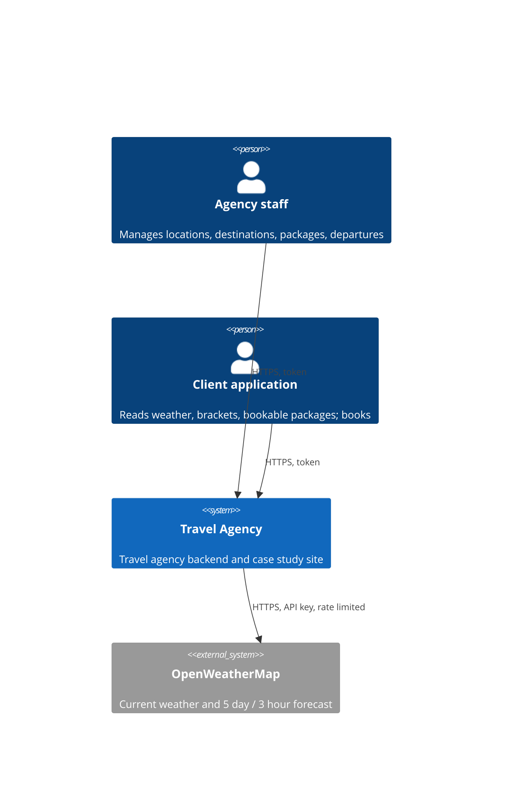
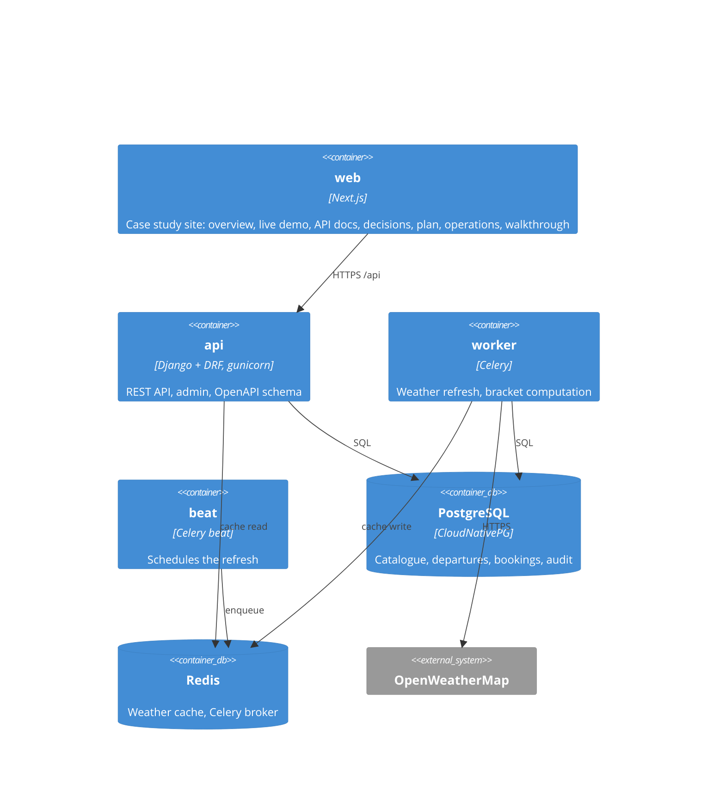
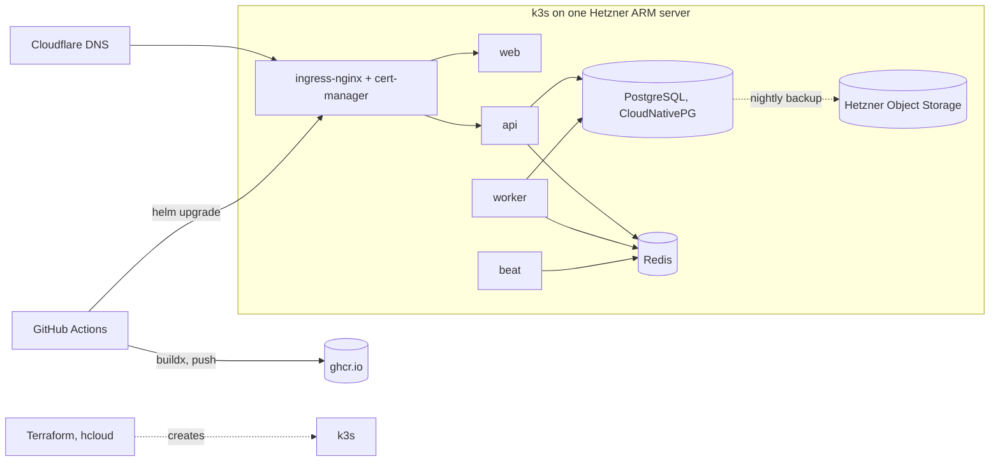

# 02 Architecture

Status: draft, 2026-10-26. Structure follows arc42; diagrams follow C4.

## 1. Introduction and goals

The system serves a travel agency with weather driven information and a product catalogue
(docs/01-requirements.md). Quality goals in order:

1. Reliability toward the upstream weather API: the system answers even when OpenWeatherMap is
   slow, down or rate limiting.
2. Correctness of the product model: capacity, availability and danger are never ambiguous.
3. Operability: one command to run locally, one pipeline to deploy, visible health.
4. Maintainability: thin views, explicit services, tests at the seams, documented decisions.

## 2. Constraints

- Stack: Python, Django, Django REST Framework, PostgreSQL, Redis (ADR 0001).
- Free tier of OpenWeatherMap: 60 calls per minute, 3 hour forecast slots, no daily endpoint.
- Portable deployment: the application depends only on standard interfaces (PostgreSQL, Redis,
  S3 compatible storage, OpenTelemetry) so that the same Helm chart runs on any Kubernetes
  (ADR 0006).

## 3. Context (C4 level 1)

## 4. Solution strategy

- Weather is read through one adapter with a cache in front (Redis). Requests never fan out to
  the upstream on the hot path for known locations; a scheduled job refreshes them (ADR 0005).
- The product model separates the catalogue (package, destination) from the sellable unit
  (departure: package + date + capacity). Bookings reduce remaining seats under a row lock
  (ADR 0002).
- Derived values (package danger, remaining seats) are computed in queries, not stored, until a
  measured need says otherwise (ADR 0003).
- Everything is a container; one Helm chart; environment differences live in values files only.

## 5. Building blocks (C4 level 2, containers)

Django apps inside `api` (C4 level 3 comes with the code): `weather` (adapter, cache,
aggregation), `locations` (list, seed, brackets), `catalog` (destination, package),
`booking` (departure, booking, availability query), `core` (auth, errors, audit, health).

## 6. Runtime views

Documented as sequence diagrams once the code exists:

- R1 Current weather request, cache hit and cache miss paths, stale fallback.
- R2 Scheduled refresh of all locations: fetch, upsert weather samples, write cache; rate
  limit budget, partial failure.
- R3 Bookable packages query (date range on the departure date, ADR 0011).
- R4 Booking under concurrency (two clients, one seat left).

## 7. Deployment view

Values files: `values-hetzner.yaml` (this deployment), `values-local.yaml` (kind),
`values-azure.yaml` (AKS with managed PostgreSQL and Redis; documented, not run). ADR 0006,
0007, 0009.

## 8. Cross cutting concepts

- Errors: RFC 7807 problem details on every non 2xx response.
- Auth: token per user, two groups (staff, client). Admin for staff.
- Audit: who changed what and when on catalogue and departures; soft delete.
- Idempotency: booking requests carry an idempotency key.
- Observability: structured JSON logs, OpenTelemetry traces, `/healthz` and `/readyz`,
  Prometheus metrics when the monitoring stack is installed.
- Configuration: environment variables only, documented in `.env.example`.

## 9. Architecture decisions

See docs/adr/README.md.

## 10. Quality scenarios

| Id | Scenario | Response |
|---|---|---|
| Q1 | OpenWeatherMap returns 5xx for 10 minutes | Weather endpoints keep answering from cache, marked stale; refresh job backs off |
| Q2 | 13 locations, refresh every 15 minutes | Stays far under 60 calls per minute; budget tracked; samples table grows by about 400 rows a day and is pruned at 90 days |
| Q3 | Two bookings for the last seat at the same moment | One succeeds, one gets 409; no overbooking |
| Q4 | Deploy a new api version | Rolling update, no failed requests, migrations run first |
| Q5 | Server lost | Terraform recreates, Helm reinstalls, PostgreSQL restored from last backup |

## 11. Risks and technical debt

Single node (no HA), free tier weather data, operator managed database on one disk. Each is
named in 07-roadmap.md with the step that removes it.

## 12. Glossary

Departure: a package on one date with its capacity; it ends after the package's duration. Bookable: departure in range, in the
future, seats remaining. Danger score: 0 none, 1 low, 2 medium, 3 high. Weather sample: one 3 hour forecast slot or one
observation for a known location, stored in UTC. Local day: the calendar day in the location's
IANA zone.
