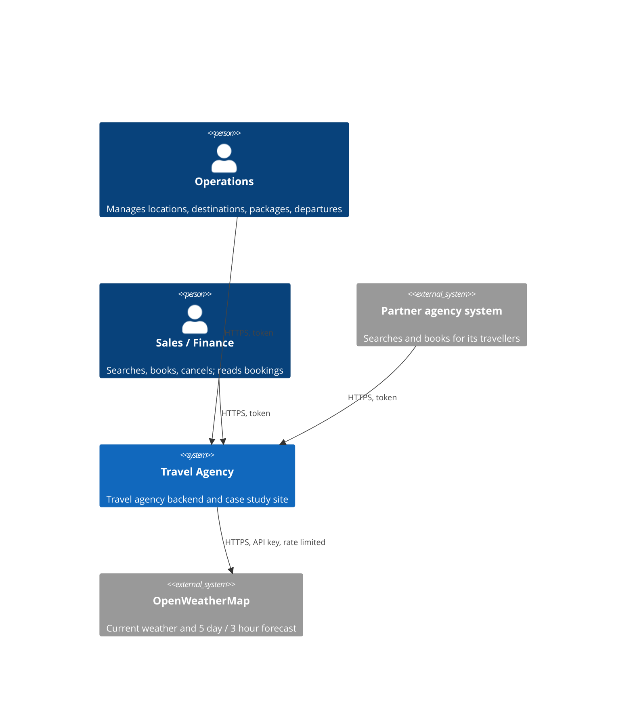
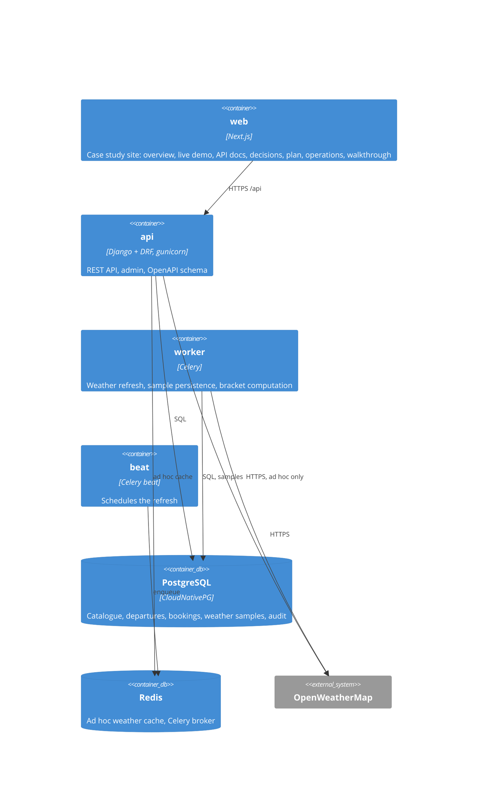
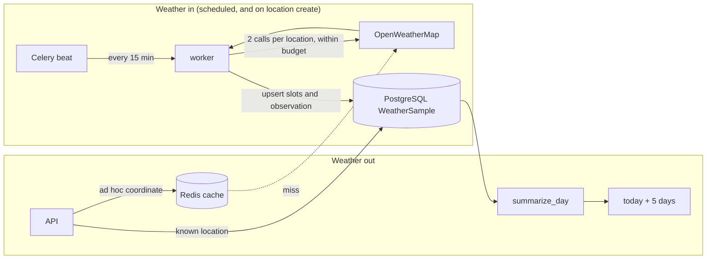
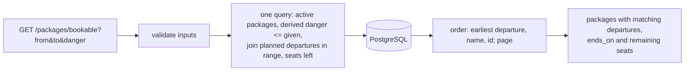
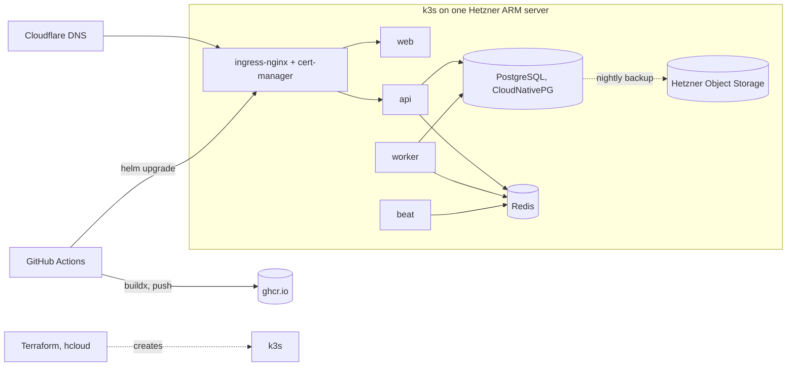

# 02 Architecture

Status: draft, 2026-10-26. Structure follows arc42 (docs.arc42.org), subsection by
subsection; diagrams follow C4. Open items are marked `TODO` and tracked in [arc42-checklist.md](arc42-checklist.md).

## 0. Summary (one page)

**What it does, and for whom.** A backend for a travel agency: live weather for coordinates
and for the agency's locations, those locations grouped by temperature bracket, and a product
catalogue of packages, destinations and dated departures with capacity, searchable by date
range and danger score, with bookings that never oversell. Operations manage the catalogue,
sales and partner agencies search and book, finance reads; travellers are served through them
and never call the API (00-domain). It runs as a Django + DRF API with Celery workers,
PostgreSQL and Redis, packaged as one Helm chart on Kubernetes, with a Next.js case study
site in front. Requirements and the sixteen assumptions that close the brief's gaps are in
01-requirements.

**Structure.** Four Django apps behind one API: `weather` (upstream adapter, samples, daily
summaries), `locations` (list, seed, brackets), `catalog` (destinations, packages),
`booking` (departures, bookings, the bookable search); `core` carries token auth with the
four roles, problem-detail errors, trigger-based change history and health. A worker and a
scheduler sit beside the API; the container diagram is in §5.1.

**Two data flows.** Weather comes in on a schedule: the worker fetches every known location
from OpenWeatherMap (and a new location at once), upserts the slots and observations into
PostgreSQL, and the API computes daily summaries from there; ad hoc coordinates are fetched
on request and cached briefly in Redis. The bookable search goes out from one query: active
packages whose derived danger fits, joined to planned departures in the date range with seats
left, ordered and paged, each with its end date and remaining seats (§6).

**Three main decisions.** The departure (package + date + capacity) is the sellable unit, and
a booking takes a row lock on it, so two sales of the last seat cannot both succeed (ADR 0002;
the alternative, capacity on the package, could not express a sold out date). The package's
danger is derived in the query from its destinations, never stored, so a changed trail is
reflected at once (ADR 0003; a stored column is the documented next step if measured cost
asks for it). Known locations are never fetched on the request path: a scheduled job writes to
PostgreSQL inside the upstream's budget and the API reads from there, with stale fallback and
a circuit breaker (ADR 0005, 0012; the alternative, calling upstream per request, breaks under
the free tier's limits and outages).

**Quality order and limits.** Reliability toward the upstream first, then correctness of
capacity and danger, then operability, then maintainability (§1.2). One server, no high
availability, no event streaming, no payments or traveller self-service in this iteration;
each is in 07-roadmap with what it would take.

**Stack and why.**

| Element | Role | Decision |
|---|---|---|
| Python, Django, DRF | API, admin for operations, ORM, migrations, OpenAPI | ADR 0001 |
| Celery (+ beat) | Scheduled and on-create weather refresh | ADR 0005 |
| PostgreSQL (CloudNativePG) | Catalogue, departures, bookings, weather samples, history tables | ADR 0007, 0012, 0014 |
| Redis | Ad hoc weather cache, Celery broker | ADR 0005 |
| OpenWeatherMap, free tier | Current weather and 3 hour forecast slots; the only external data source | F1 to F3 |
| Helm on k3s (Hetzner ARM), Terraform, ingress-nginx, cert-manager | One chart, values per environment including an Azure (AKS) profile; HTTPS | ADR 0006, 0009 |
| Next.js | Case study site: demo, docs, operations, walkthrough | 05-work-packages W |

Everything below is the long form (arc42); decisions are in [adr/](adr/README.md).

## 1. Introduction and goals

### 1.1 Requirements overview

A travel agency backend: weather for coordinates and for the agency's locations (grouped by
temperature bracket), and the product catalogue (packages, destinations, dated departures with
capacity) with a bookable-packages search by date range and danger score, plus bookings that
never oversell.

Driving forces (00-domain): the agency owner wants to run the agency without developer help
for everyday changes; sales wants to answer "these dates, nothing too risky" in one query and
book without double selling; marketing wants weather it can sell with; partner agencies want a
contract they can integrate against once.

Requirements and their acceptance checks are in [01-requirements.md](01-requirements.md):
W1 to W4 weather, L1 to L4 locations and brackets, P1 to P6 catalogue, departures and booking,
N1 to N6 qualities, F1 to F5 facts about the environment, A1 to A16 assumptions that close
the brief's gaps.

### 1.2 Quality goals

Top goals in priority order, named after ISO 25010 characteristics, each with what measures
it (quality scenarios in §10.2, requirements in 01).

| # | Goal | ISO 25010 | Meaning here | Measured by |
|---|---|---|---|---|
| 1 | Reliability toward the upstream | reliability: fault tolerance, availability | Answers even when OpenWeatherMap is slow, down or rate limiting; its budget is never exceeded | Q1, Q2; W1.4, W1.5, W4 |
| 2 | Correctness of the product model | functional suitability: correctness | Capacity, availability and danger are never ambiguous or stale | Q3; P3, P4, P5, P6 |
| 3 | Operability: deploy, recover, observe | reliability: recoverability; maintainability: modifiability | One command locally, one pipeline to deploy, rollback in one command, restorable from backup, visible health and budget | Q4, Q5; N5 |
| 4 | Security | security: confidentiality, integrity, accountability | Token per user with four roles, partners see only their own data, no secrets in git, callers rate limited, every change attributed | N6; W4.3; 00-domain §5 |
| 5 | Maintainability | maintainability: modularity, testability, analysability | Thin views, services per app, tests at the seams, lint and types clean, documented decisions | Q6, Q7; N3.3 |

### 1.3 Stakeholders

Defined in [00-domain.md](00-domain.md) section 2 (role, channel, expectations, actor). In
short: the agency owner commissions and reads; operations, sales, finance and partner agencies
are the actors (roles `ops`, `sales`, `finance`, `partner`); travellers are data subjects, not
users, in this iteration; regulators and suppliers are indirect; the operator and
OpenWeatherMap sit inside the system boundary.

The expectations that shaped the architecture most:

- Operations: change the catalogue, dates and capacity without a developer. The Django admin
  and the `ops` role (ADR 0001).
- Sales: one query for "these dates, at most this danger", and no double selling. The bookable
  search (P5) and the row lock on the departure (ADR 0002).
- Partner agencies: a stable, documented contract and isolation from each other. OpenAPI
  schema, versioned path, partner-scoped bookings (04-api, 00-domain §5).
- Finance and regulators: who changed what, when, and what a record looked like. Trigger-based
  history (ADR 0014).
- Operator: reproducible from code, one command to deploy or roll back, health and budget
  visible. Terraform, Helm, CI, the operations status (ADR 0006, 0009).

## 2. Constraints

What was imposed on the design, by whom, and how the design complies or deviates.

| Group | Constraint | Source | How we comply or deviate |
|---|---|---|---|
| Given by the brief | Python, Django, PostgreSQL, Redis | the brief's stack | Complied; DRF and Celery are our additions on top (ADR 0001, 0005) |
| Given by the brief | Cloud: "Azure or AWS" | the brief's stack | **Deviates for the demo**: k3s on a Hetzner server for cost and portability; an AKS values profile is kept and documented, the application has no provider-specific dependency (ADR 0006) |
| Given by the brief | Weather from OpenWeatherMap, free tier only | the brief | Complied; shapes W3, W4 and ADR 0005, 0012 |
| Environment | Upstream data shape, limits, unreliability, time zone rules, uncontrolled callers | F1 to F5 in 01-requirements | Scheduled refresh into PostgreSQL, budget split, circuit breaker, IANA zones, per-caller limits |
| Organisational, budget | Short fixed time box; one developer; one environment (no staging); no on-call; low monthly cost (one small server, free tiers) | project setting | Scope cut by work packages (05); risks of a single node named in §11 and the roadmap |
| Legal | Traveller personal data (name, email) falls under GDPR: minimise, protect, be able to erase; no payment data is ever stored | 00-domain §2 (regulators) | Only name and email kept; no card or payment fields; access by role; history tables carry data changes; erasure flow in the roadmap |
| Self-imposed | Portability: the application depends only on PostgreSQL, Redis, S3 compatible storage and OpenTelemetry | ADR 0006 | One Helm chart, values per environment (Hetzner, local kind, AKS) |
| Conventions | English; requirements in the ISO 29148 form with acceptance checks; one MADR per decision with Addresses line; arc42 + C4 for architecture; data model standards table (03); code files under 200 lines, documents exempt; ruff, mypy, pytest; Next.js App Router with shadcn/ui; no secrets in git; no AI attribution in commits | AGENTS.md, 01 §2, 03 | Checked in review and CI |

Degrees of freedom: the framework and the data stores are fixed by the brief; the cloud
provider, the Kubernetes distribution, the libraries inside the stack and the deployment
topology were free, and the choices are argued in ADR 0005 to 0009 and 0014.

## 3. Context and scope

### 3.1 Business context

| Partner | Inputs to the system | Outputs from the system |
|---|---|---|
| Operations | Locations, destinations, packages, departures, capacity, bracket edges | Admin views, sold-out state, refresh status |
| Sales | Search criteria (dates, danger, traveller), bookings, cancellations | Bookable packages with departures and seats, booking confirmations |
| Finance | Date ranges | Bookings with price and departure |
| Partner agency system | Search criteria, bookings for its own travellers | Same as sales, scoped to its bookings |
| OpenWeatherMap | Coordinates, API key | Current observation, 40 three hour forecast slots |

### 3.2 Technical context

| Channel | Protocol | Carries |
|---|---|---|
| Public API | HTTPS, JSON, `Authorization: Token`, OpenAPI 3 | Every input and output of operations, sales, finance and partners |
| Django admin | HTTPS, session | Operations' catalogue edits (same data as the API) |
| Upstream weather | HTTPS, API key in query, JSON | Coordinates out; observations and forecast slots in |
| Cluster internal | PostgreSQL wire protocol, Redis protocol (TLS off inside the node) | Persistence, cache, task queue |
| Backups | S3 API over HTTPS | PostgreSQL base backups and WAL |
| Delivery | HTTPS to ghcr.io and the Kubernetes API | Images and Helm releases |

## 4. Solution strategy

- Weather comes through one adapter. Known locations are refreshed by a scheduled job into
  PostgreSQL and read from there; ad hoc coordinates are fetched on miss and cached briefly in
  Redis (ADR 0005, 0012); daily summaries follow ADR 0013.
- The product model separates the catalogue (package, destination) from the sellable unit
  (departure: package + date + capacity). Bookings reduce remaining seats under a row lock
  (ADR 0002).
- Derived values (package danger, remaining seats) are computed in queries, not stored, until a
  measured need says otherwise (ADR 0003).
- Everything is a container; one Helm chart; environment differences live in values files only
  (ADR 0006).

## 5. Building block view

### 5.1 Level 1: containers (C4 level 2)

`TODO (arc42 5.1)`: black box table per container: purpose, interfaces, location in the repo.

### 5.2 Level 2: Django apps inside `api`

`weather` (adapter, cache, samples, daily summary), `locations` (list, seed, brackets),
`catalog` (destination, package), `booking` (departure, booking, availability query), `core`
(auth, errors, audit, health). `TODO (arc42 5.2)`: C4 component diagram and black box table once
the code exists.

## 6. Runtime view

### 6.1 Data flows

### 6.2 Scenarios

`TODO (arc42 6)`: sequence diagrams once the code exists, one per scenario:

- R1 Current weather request: known location from samples; ad hoc coordinate cache hit,
  miss, stale fallback, 503 when nothing is stored.
- R2 Scheduled refresh of all locations (and the immediate refresh on create): fetch, upsert
  weather samples; rate limit budget, partial failure.
- R3 Bookable packages query (date range on the departure date, ADR 0011).
- R4 Booking under concurrency (two clients, one seat left).

## 7. Deployment view

Values files: `values-hetzner.yaml` (this deployment), `values-local.yaml` (kind),
`values-azure.yaml` (AKS with managed PostgreSQL and Redis; documented, not run). ADR 0006,
0007, 0009. `TODO (arc42 7)`: node sizing, namespaces and the mapping of containers to pods.

## 8. Cross cutting concepts

- Errors: RFC 7807 problem details on every non 2xx response.
- Auth: token per user, one role per user: `ops`, `sales`, `partner` (scoped to its own
  bookings), `finance` (00-domain.md section 5). Admin for `ops`.
- History: per-table history tables filled by database triggers with the acting user and
  request, "as of" reads (ADR 0014); soft delete on catalogue tables.
- Idempotency: booking requests carry an idempotency key.
- Rate limiting: per token on ad hoc weather requests; the upstream budget is split between
  the scheduled refresh and ad hoc calls (W4, ADR 0005).
- Time: UTC in storage, IANA zone per location, local days computed in code (ADR 0013).
- Observability: structured JSON logs, OpenTelemetry traces, `/healthz` and `/readyz`,
  Prometheus metrics when the monitoring stack is installed.
- Configuration: environment variables only, documented in `.env.example`; operational settings
  that operations change (bracket edges, agency time zone) live in a settings table.

## 9. Architecture decisions

See [adr/README.md](adr/README.md).

## 10. Quality requirements

### 10.1 Quality requirements overview

`TODO (arc42 10.1)`: quality tree from the four goals in 1.2 down to the scenarios in 10.2.

### 10.2 Quality scenarios

Short form: context, stimulus, response, metric. U = usage scenario, C = change scenario.

| Id | Type | Stimulus | Response | Metric |
|---|---|---|---|---|
| Q1 | U | OpenWeatherMap returns 5xx for 10 minutes | Weather endpoints answer from cache, marked stale; refresh job backs off | 0 upstream-caused 5xx; p95 latency unchanged |
| Q2 | U | 13 locations refreshed every 15 minutes | Within the upstream budget; samples pruned at 90 days | < 5 calls/min of 60; table < 40k rows |
| Q3 | U | Two bookings for the last seat at the same moment | One succeeds, one gets 409 | 0 overbookings in the concurrency test |
| Q4 | U | Deploy a new api version | Rolling update, migrations first | 0 failed requests during rollout |
| Q5 | U | Server lost | Terraform recreates, Helm reinstalls, PostgreSQL restored | restore drill under 30 minutes; RPO one night |
| Q6 | C | Client changes the danger semantics to exact match | One query change, tests updated | under one hour, one ADR |
| Q7 | C | A new weather provider | New adapter behind the same interface | no change outside `weather` |

## 11. Risks and technical debt

| Priority | Risk or debt | Consequence | Measure |
|---|---|---|---|
| 1 | Single node, single disk | Outage on server loss until restored | Backups + restore drill now; second node and replica in the roadmap |
| 2 | Free tier weather data | No history, 3 hour resolution, 120 hour window | Persisted samples (ADR 0012); paid tier if the client needs more |
| 3 | Operator-managed database with one instance | No failover | Two instances is one setting once a second node exists |
| 4 | First day after deployment | Today's summary partial | Stated in the response (`partial`) |

## 12. Glossary

| Term | Definition |
|---|---|
| Departure | A package on one date with its capacity; ends after the package's duration |
| Bookable | Departure in the requested range, in the future, with seats remaining |
| Danger score | 0 none, 1 low, 2 medium, 3 high; a package's score is the max of its destinations |
| Weather sample | One 3 hour forecast slot or one observation for a known location, stored in UTC |
| Local day | The calendar day in the location's IANA zone |

Business terms are defined once in [00-domain.md](00-domain.md) section 4; this table keeps the
technical ones only.
