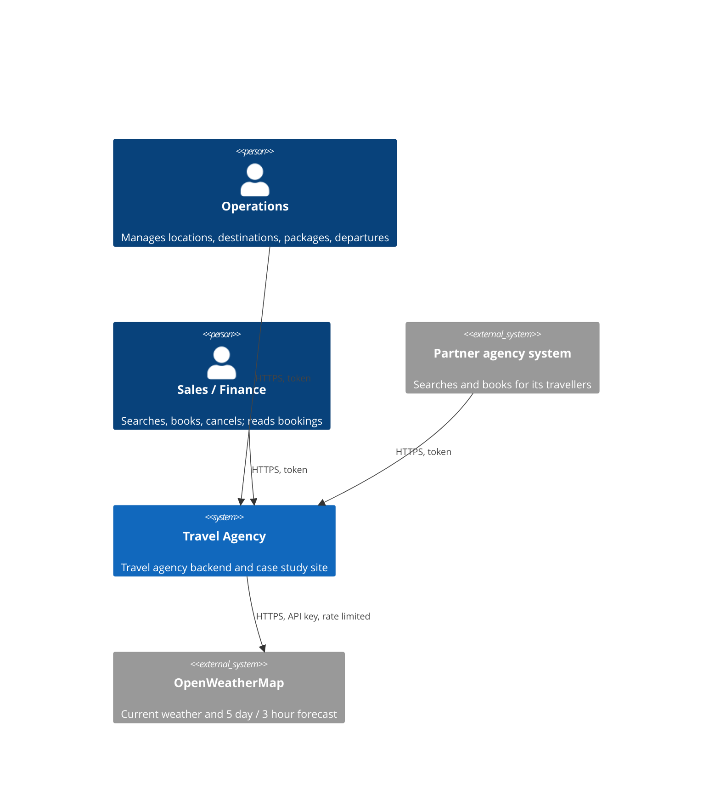
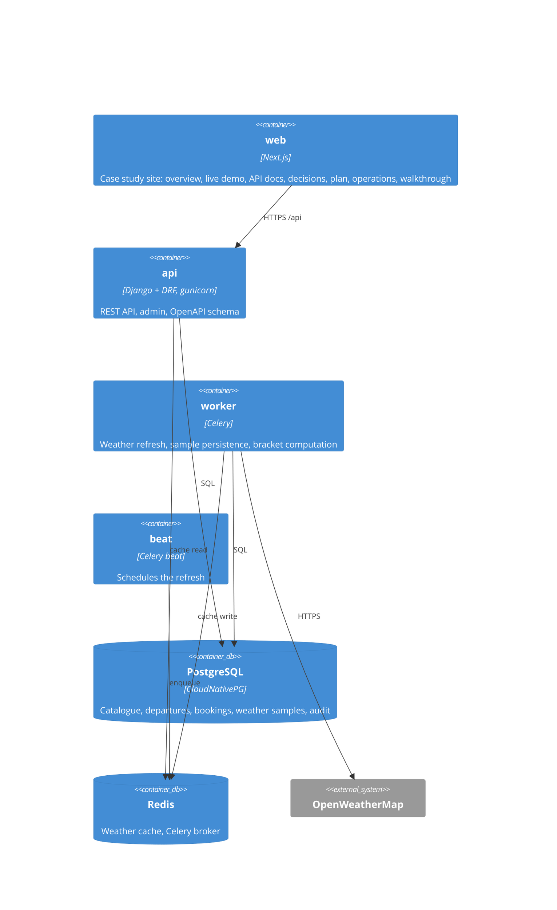
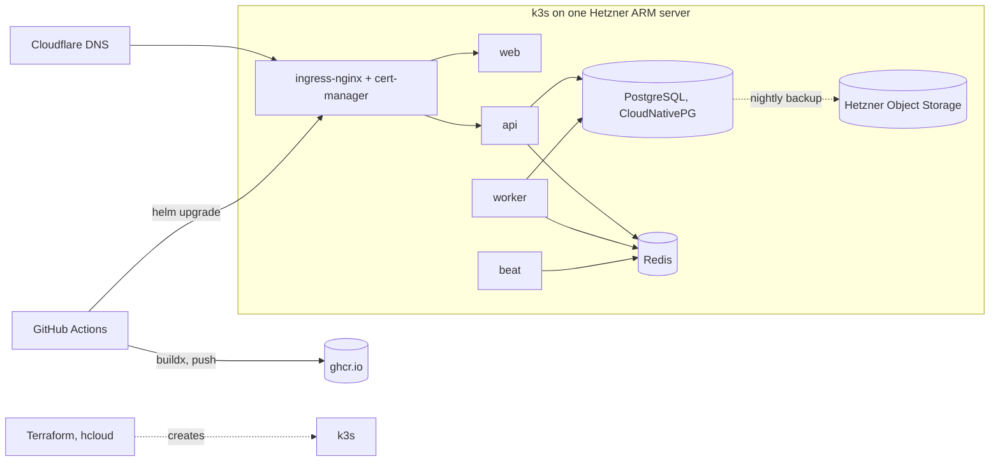

# 02 Architecture

Status: draft, 2026-10-26. Structure follows arc42 (docs.arc42.org), subsection by
subsection; diagrams follow C4. Sections 10 to 12 are in [02b-quality-risks-glossary.md](02b-quality-risks-glossary.md). Open
items are marked `TODO` and tracked in [arc42-checklist.md](arc42-checklist.md).

## 1. Introduction and goals

### 1.1 Requirements overview

A travel agency backend: weather for coordinates and for the agency's locations (grouped by
temperature bracket), and the product catalogue (packages, destinations, dated departures with
capacity) with a bookable-packages search by date range and danger score. Full list and
assumptions: [01-requirements.md](01-requirements.md).

### 1.2 Quality goals

Top goals in priority order, named after ISO 25010 characteristics:

| # | Goal | ISO 25010 | Meaning here |
|---|---|---|---|
| 1 | Reliability toward the upstream | reliability: fault tolerance, availability | Answers even when OpenWeatherMap is slow, down or rate limiting |
| 2 | Correctness of the product model | functional suitability: correctness | Capacity, availability and danger are never ambiguous |
| 3 | Operability | maintainability: modifiability; reliability: recoverability | One command locally, one pipeline to deploy, visible health, restorable |
| 4 | Maintainability | maintainability: modularity, testability | Thin views, explicit services, tests at the seams, documented decisions |

### 1.3 Stakeholders

Defined in [00-domain.md](00-domain.md) section 2 (role, channel, expectations, actor). In
short: the agency owner commissions and reads; operations, sales, finance and partner agencies
are the actors (roles `ops`, `sales`, `finance`, `partner`); travellers are data subjects, not
users, in this iteration; regulators and suppliers are indirect; the operator and
OpenWeatherMap sit inside the system boundary.

## 2. Constraints

| Kind | Constraint | Source |
|---|---|---|
| Technical | Python, Django, DRF, PostgreSQL, Redis | the brief; ADR 0001 |
| Technical | OpenWeatherMap free tier: 60 calls/min, 3 hour slots, 120 hour window, no history | upstream; ADR 0005, 0012 |
| Technical | Portable: only PostgreSQL, Redis, S3 compatible storage, OpenTelemetry as dependencies | ADR 0006 |
| Organisational | One developer, a few days; delivered as a live system plus documents | project setting |
| Convention | English; ADR per decision; files under 200 lines; no secrets in git | AGENTS.md |

## 3. Context and scope

### 3.1 Business context

| Partner | Inputs to the system | Outputs from the system |
|---|---|---|
| Operations | Locations, destinations, packages, departures, capacity, bracket edges | Admin views, sold-out state, refresh status |
| Sales | Search criteria (dates, danger, traveller), bookings, cancellations | Bookable packages with departures and seats, booking confirmations |
| Finance | Date ranges | Bookings with price and departure |
| Partner agency system | Search criteria, bookings for its own travellers | Same as sales, scoped to its bookings |
| OpenWeatherMap | Coordinates, API key | Current observation, 40 three hour forecast slots |

### 3.2 Technical context

| Channel | Protocol | Carries |
|---|---|---|
| Public API | HTTPS, JSON, `Authorization: Token`, OpenAPI 3 | Every input and output of operations, sales, finance and partners |
| Django admin | HTTPS, session | Operations' catalogue edits (same data as the API) |
| Upstream weather | HTTPS, API key in query, JSON | Coordinates out; observations and forecast slots in |
| Cluster internal | PostgreSQL wire protocol, Redis protocol (TLS off inside the node) | Persistence, cache, task queue |
| Backups | S3 API over HTTPS | PostgreSQL base backups and WAL |
| Delivery | HTTPS to ghcr.io and the Kubernetes API | Images and Helm releases |

## 4. Solution strategy

- Weather is read through one adapter with a cache in front (Redis). Requests never fan out to
  the upstream on the hot path for known locations; a scheduled job refreshes them and persists
  what it fetches (ADR 0005, 0012); daily summaries follow ADR 0013.
- The product model separates the catalogue (package, destination) from the sellable unit
  (departure: package + date + capacity). Bookings reduce remaining seats under a row lock
  (ADR 0002).
- Derived values (package danger, remaining seats) are computed in queries, not stored, until a
  measured need says otherwise (ADR 0003).
- Everything is a container; one Helm chart; environment differences live in values files only
  (ADR 0006).

## 5. Building block view

### 5.1 Level 1: containers (C4 level 2)

`TODO (arc42 5.1)`: black box table per container: purpose, interfaces, location in the repo.

### 5.2 Level 2: Django apps inside `api`

`weather` (adapter, cache, samples, daily summary), `locations` (list, seed, brackets),
`catalog` (destination, package), `booking` (departure, booking, availability query), `core`
(auth, errors, audit, health). `TODO (arc42 5.2)`: C4 component diagram and black box table once
the code exists.

## 6. Runtime view

`TODO (arc42 6)`: sequence diagrams once the code exists, one per scenario:

- R1 Current weather request: cache hit, cache miss, stale fallback.
- R2 Scheduled refresh of all locations: fetch, upsert weather samples, write cache; rate
  limit budget, partial failure.
- R3 Bookable packages query (date range on the departure date, ADR 0011).
- R4 Booking under concurrency (two clients, one seat left).

## 7. Deployment view

Values files: `values-hetzner.yaml` (this deployment), `values-local.yaml` (kind),
`values-azure.yaml` (AKS with managed PostgreSQL and Redis; documented, not run). ADR 0006,
0007, 0009. `TODO (arc42 7)`: node sizing, namespaces and the mapping of containers to pods.

## 8. Cross cutting concepts

- Errors: RFC 7807 problem details on every non 2xx response.
- Auth: token per user, one role per user: `ops`, `sales`, `partner` (scoped to its own
  bookings), `finance` (00-domain.md section 5). Admin for `ops`.
- Audit: who changed what and when on catalogue and departures; soft delete.
- Idempotency: booking requests carry an idempotency key.
- Time: UTC in storage, IANA zone per location, local days computed in code (ADR 0013).
- Observability: structured JSON logs, OpenTelemetry traces, `/healthz` and `/readyz`,
  Prometheus metrics when the monitoring stack is installed.
- Configuration: environment variables only, documented in `.env.example`.

## 9. Architecture decisions

See [adr/README.md](adr/README.md).
