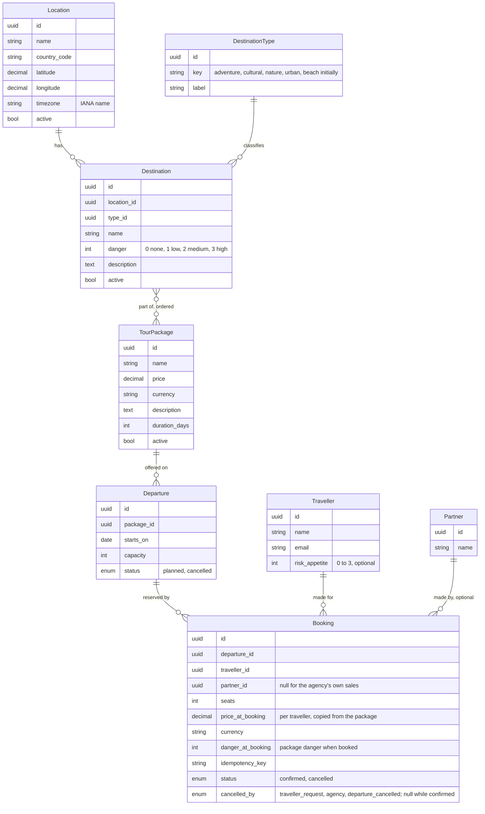

# 03 Data model

Status: draft, 2026-10-26.

## Entities

## Weather samples

Weather is not part of the catalogue, but what the worker fetches for known locations is kept
(ADR 0012): `WeatherSample(location_id, slot_time timestamptz, kind forecast|observation,
fetched_at, temp, temp_min, temp_max, condition_code, condition_label, pop, raw jsonb)`,
unique on (location_id, slot_time, kind), upserted on every fetch so the newest forecast wins
and an observation supersedes the forecast of its hour. Pruned after 90 days. The API reads these
samples for known locations; ad hoc coordinates are served from Redis only. All timestamps are UTC; local days are computed with
the location's IANA zone (ADR 0013).

## Derived values

- Departure end date = starts_on + duration_days - 1; reported as `ends_on`, not stored (ADR 0011).
- Package danger = max(danger) over its destinations, inactive ones included. Computed in the
  query with an annotation; not stored (ADR 0003); null when the package has no destinations.
- Remaining seats = capacity minus sum(seats) of confirmed bookings. Computed in the query;
  the booking write takes a row lock on the departure (ADR 0002).
- Package suitability for a traveller = package danger <= traveller risk appetite (extra feature).

## Constraints

- Departure: unique (package_id, starts_on); capacity > 0; capacity never below confirmed
  seats; delete refused while bookings exist (cancel instead, which cancels its bookings with
  `departure_cancelled`).
- TourPackage: duration_days >= 1; description at most 2,000 characters; price per traveller
  (A15); delete refused while any departure has bookings (deactivate instead).
- Booking: seats > 0 and at most remaining at write time under a row lock; unique
  idempotency_key per caller; a `partner` user's bookings carry
  its partner_id and are the only ones it can read.
- Location: unique (name, country_code); latitude in [-90, 90], longitude in [-180, 180];
  timezone must be a valid IANA name, derived from the coordinates with an offline lookup when
  not given; `active = false` removes it from brackets and the refresh without deleting;
  delete is refused while active destinations reference it.
- WeatherSample: unique (location_id, slot_time, kind).
- Destination danger in [0, 3]; unique (location_id, name); delete refused while any package
  references it; `active = false` only blocks adding it to new packages.
- DestinationType: `key` unique; maintained by operations, not a code enum.

## Indexes

- Departure (starts_on) for the date range filter.
- Booking (departure_id, status) for the remaining seats aggregate.
- Destination (location_id); the package to destination join table on both keys, with a
  `position` column and unique (package_id, destination_id).
- WeatherSample (location_id, slot_time) for the daily summary read.

## Seed data

Locations (L2): Buenos Aires, Sucre and La Paz, Brasília, Santiago, Bogotá, Quito, Georgetown,
Asunción, Lima, Paramaribo, Montevideo, Caracas; thirteen rows with ISO country code, IANA
zone and coordinates whose source the seed file cites. Cayenne is excluded (A5). The seed is
idempotent and never overwrites edited rows.

Demo data (optional, separate command): a handful of destinations and three packages with
departures across the next ninety days, so that the bookable query has something to return.

## History and soft delete

Catalogue tables, Departure, Location and the settings rows carry `created_at`, `updated_at`
and, where soft delete applies, `deleted_at`. Change history is kept by database triggers in
per-table history tables with the acting user and request (ADR 0014), readable "as of" a time.
Bookings are never deleted; they are cancelled.

## Standards and practices followed

What this model follows, where it shows, and how it is checked. Items marked "noted" are
known alternatives that were considered and not adopted, with the reason.

### Standards

| Source | Rule adopted | Where | Checked by |
|---|---|---|---|
| ISO/IEC 9075 (SQL) | Integrity in the database: FOREIGN KEY, UNIQUE, CHECK; `timestamp with time zone` | every table; N2.1, N2.3 | migrations, `test_schema.py` |
| ISO/IEC 9075:2011 system-versioned tables | Not available in PostgreSQL; emulated with trigger-filled history tables | ADR 0014; N2.5 | history tables exist and fill in tests |
| ISO 8601 | Dates and timestamps in the API and in storage | all `_on` / `_at` columns; API | serializer tests |
| ISO 4217 | Currency as a three letter code beside `numeric(12,2)` | Package.currency, Booking.currency; A7, A15 | CHECK on length and a known-code list |
| ISO 3166-1 alpha-2 | Country codes on locations | Location.country_code; L2 | CHECK, seed |
| IANA tz database | Zone names on locations; local-day computation | Location.timezone; A13, ADR 0013 | validation against `zoneinfo` |
| ISO/IEC 11179 (metadata) | Every column has a name, type, definition and allowed values | this file's entity blocks; 00-domain §4 glossary | review |
| ISO/IEC 25012 / ISO 8000 (data quality) | Completeness and currency made visible, not hidden | `partial`, sample counts, `observed_at`, `stale` (W2, L3) | API tests |
| IDEF1X / IE notation | Crow's foot ER diagram | this file (Mermaid `erDiagram`) | renders on GitHub and the site |

### Bodies of knowledge and patterns

| Source | Rule adopted | Where | Checked by |
|---|---|---|---|
| DAMA-DMBOK | Conceptual model separate from logical and physical | 00-domain (conceptual), this file (logical, physical) | review |
| Codd, normal forms | Third normal form; derived values computed, not stored | package danger, remaining seats, end date; ADR 0003, 0011 | no derived columns in migrations |
| Fowler, Money pattern | `numeric(12,2)` + currency code, never `money` or floats | prices | CHECK, type assertions in tests |
| Fowler, Snapshot pattern | Booking keeps price and danger at booking time | Booking; P1.2, P4.5 | booking tests |
| Kimball, slowly changing dimensions | History kept in separate per-table history tables (type 4 like) | ADR 0014 | history tests |
| Evans, DDD aggregates | Departure + Booking is one consistency boundary (row lock there); Package + destinations another | ADR 0002; booking service | concurrency test (P6.2) |

### PostgreSQL and Django practice

| Source | Rule adopted | Where | Checked by |
|---|---|---|---|
| PostgreSQL wiki "Don't Do This" | `timestamptz`; `numeric`; `text` + CHECK not `varchar(n)`; no `char(n)`, no `money`, no `timetz`; identity or UUID keys; lower case identifiers | all tables; N2.3 | squawk / review of migrations |
| PostgreSQL docs, constraints and indexes | Indexes only for named queries; plans documented; `NOT VALID` then `VALIDATE` for constraints on large tables | P5, L3, W2 indexes; N2.6 | EXPLAIN files in `docs/plans/` |
| SQL style (Holywell) and Django defaults | snake_case, Django's `app_model` table names kept consistently, 63 char limit respected | all tables | review |
| Zero downtime migrations (django-pg-zero-downtime-migrations rules) | NOT NULL with default, `CREATE INDEX CONCURRENTLY`, two-step column removal | migrations; Q4 | squawk in CI |
| Django `Meta.constraints` | CHECK and UNIQUE declared on models so they land in migrations | all models | migration review |
| UUID keys | UUIDv7 (time ordered) when the library is available, else v4; small data, difference noted only | all tables | ADR note |

### Tools

| Tool | Use here | Status |
|---|---|---|
| `django-extensions graph_models` | Generate the ER diagram from models and diff against this file | planned (N2.7) |
| `pgTAP` or a Django schema test | Assert tables, columns, constraints exist | planned (`core/tests/test_schema.py`) |
| `squawk` | Lint migrations for locking and unsafe patterns | planned (CI) |
| `sqlfluff` | Lint hand-written SQL (plans, seeds) | optional |
| `django-pghistory` | Trigger-based history with actor context | planned (ADR 0014) |
| `pgaudit` | Database-level audit of statements | noted, not adopted: application-level history answers the requirement; pgaudit is an operator tool |
