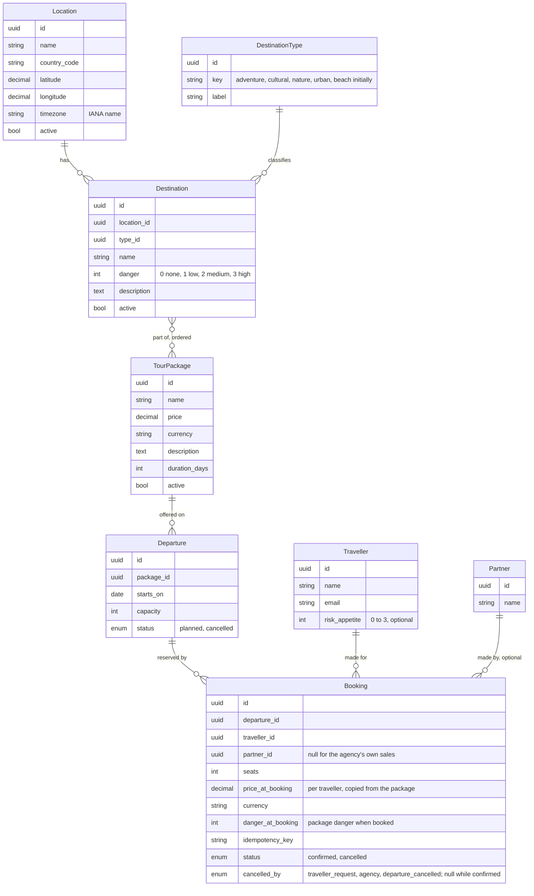

# 03 Data model

Status: draft, 2026-10-26.

## Entities

## Weather samples

Weather is not part of the catalogue, but what the worker fetches for known locations is kept
(ADR 0012): `WeatherSample(location_id, slot_time timestamptz, kind forecast|observation,
fetched_at, temp, temp_min, temp_max, condition_code, condition_label, pop, raw jsonb)`,
unique on (location_id, slot_time, kind), upserted on every fetch so the newest forecast wins
and an observation supersedes the forecast of its hour. Pruned after 90 days. The API reads these
samples for known locations; ad hoc coordinates are served from Redis only. All timestamps are UTC; local days are computed with
the location's IANA zone (ADR 0013).

## Derived values

- Departure end date = starts_on + duration_days - 1; reported as `ends_on`, not stored (ADR 0011).
- Package danger = max(danger) over its destinations, inactive ones included. Computed in the
  query with an annotation; not stored (ADR 0003); null when the package has no destinations.
- Remaining seats = capacity minus sum(seats) of confirmed bookings. Computed in the query;
  the booking write takes a row lock on the departure (ADR 0002).
- Package suitability for a traveller = package danger <= traveller risk appetite (extra feature).

## Constraints

- Departure: unique (package_id, starts_on); capacity > 0; capacity never below confirmed
  seats; delete refused while bookings exist (cancel instead, which cancels its bookings with
  `departure_cancelled`).
- TourPackage: duration_days >= 1; description at most 2,000 characters; price per traveller
  (A15); delete refused while any departure has bookings (deactivate instead).
- Booking: seats > 0 and at most remaining at write time under a row lock; unique
  idempotency_key per caller; a `partner` user's bookings carry
  its partner_id and are the only ones it can read.
- Location: unique (name, country_code); latitude in [-90, 90], longitude in [-180, 180];
  timezone must be a valid IANA name, derived from the coordinates with an offline lookup when
  not given; `active = false` removes it from brackets and the refresh without deleting;
  delete is refused while active destinations reference it.
- WeatherSample: unique (location_id, slot_time, kind).
- Destination danger in [0, 3]; unique (location_id, name); delete refused while any package
  references it; `active = false` only blocks adding it to new packages.
- DestinationType: `key` unique; maintained by operations, not a code enum.

## Indexes

- Departure (starts_on) for the date range filter.
- Booking (departure_id, status) for the remaining seats aggregate.
- Destination (location_id); the package to destination join table on both keys, with a
  `position` column and unique (package_id, destination_id).
- WeatherSample (location_id, slot_time) for the daily summary read.

## Seed data

Locations (L2): Buenos Aires, Sucre and La Paz, Brasília, Santiago, Bogotá, Quito, Georgetown,
Asunción, Lima, Paramaribo, Montevideo, Caracas; thirteen rows with ISO country code, IANA
zone and coordinates whose source the seed file cites. Cayenne is excluded (A5). The seed is
idempotent and never overwrites edited rows.

Demo data (optional, separate command): a handful of destinations and three packages with
departures across the next ninety days, so that the bookable query has something to return.

## History and soft delete

Catalogue tables, Departure, Location and the settings rows carry `created_at`, `updated_at`
and, where soft delete applies, `deleted_at`. Change history is kept by database triggers in
per-table history tables with the acting user and request (ADR 0014), readable "as of" a time.
Bookings are never deleted; they are cancelled.

## Conventions and sources

| Rule | Source |
|---|---|
| Integrity in the database: FK, UNIQUE, CHECK; application validation mirrors it | SQL standard (ISO/IEC 9075); PostgreSQL docs |
| `timestamptz` not `timestamp`; `numeric` not `money` or floats; `text` + CHECK not `varchar(n)`; identity or UUID keys; lower case snake_case | PostgreSQL wiki "Don't Do This" |
| Money = `numeric(12,2)` + ISO 4217 code; booking keeps price and danger at booking time | Fowler, Money and Snapshot patterns; ISO 4217 |
| Country codes ISO 3166-1 alpha-2; dates ISO 8601; zones IANA names | ISO 3166, ISO 8601, IANA tz database |
| Conceptual model (00-domain) separate from logical and physical (this file) | DAMA-DMBOK |
| Third normal form; derived values computed unless an ADR stores them | Codd; ADR 0003 |
| History by triggers, "as of" reads | SQL:2011 system versioning (emulated, ADR 0014) |
| Indexes justified by named queries with documented plans | PostgreSQL EXPLAIN practice |
| Schema and diagram kept equal by generation or test | pgTAP / graph_models practice |
