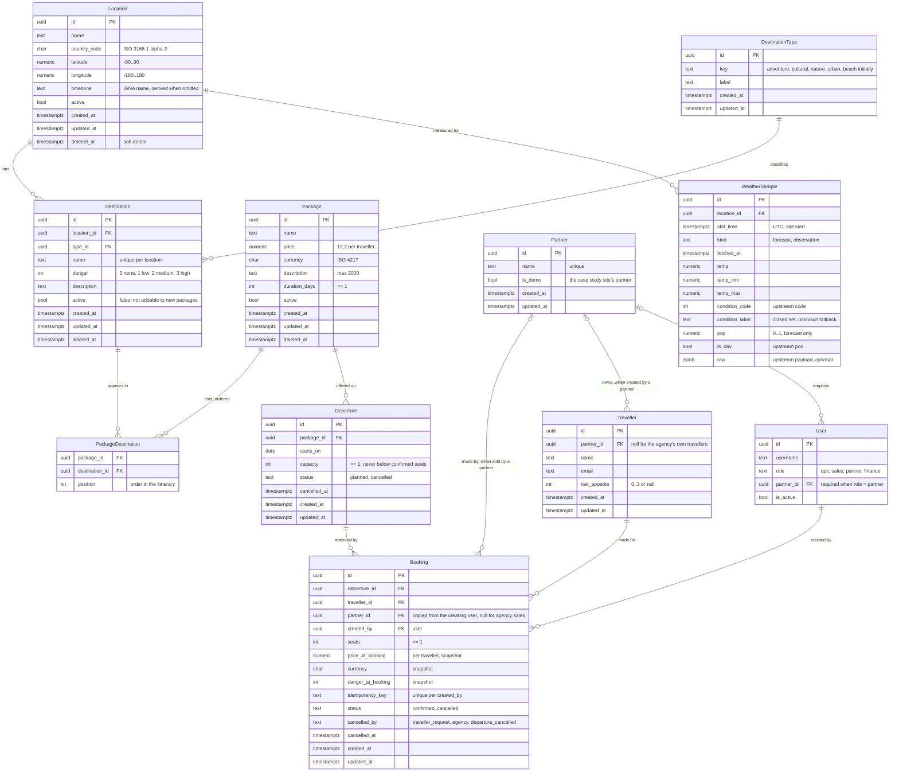

# 03 Data model

Status: reviewed against 00-domain, 01-requirements and 02-architecture, 2026-10-27.

Conceptual terms are in 00-domain §4; this file is the logical and physical model (DMBOK
split). Twelve domain tables plus the user table; history tables are generated (ADR 0014) and
not counted (N2.8).

## Entities



Two more tables without relations worth drawing:

- `RefreshRun`: one row per worker run (scheduled, on create, manual): `started_at`,
  `finished_at`, `trigger`, `locations`, `calls_used`, `failures`, `effective_interval_s`,
  `notes`. Feeds `/ops/status` and the W4.2 counters; monthly usage is the sum of
  `calls_used`. Pruned with the samples (90 days).
- `Setting`: `key` (unique: `bracket_edges`, `agency_timezone`, `sample_retention_days`),
  `value jsonb`, `updated_at`; history by trigger so a changed edge list is attributed
  (L4.2).

Users are Django's auth user with two added columns (`role`, `partner_id`) as the custom user
model; tokens are DRF tokens, one per user. The `demo` partner is a `Partner` row with
`is_demo = true` and one user of role `partner`.

## Derived values (never stored)

| Value | Rule | Where |
|---|---|---|
| Package danger | `max(destination.danger)` over its destinations, inactive included; null when none | annotation; ADR 0003, P4 |
| Danger label | none, low, medium, high from the score | serializer; P4.3 |
| Departure end date | `starts_on + duration_days - 1` | annotation; ADR 0011 |
| Confirmed seats, remaining seats | `sum(seats)` of confirmed bookings; `capacity - confirmed` | annotation under the row lock on write; ADR 0002 |
| Bookable | package active and danger not null, departure planned, `starts_on` in range and on or after today in the agency's zone, remaining > 0 | one query; P5, A3, A16 |
| Suitability | package danger <= traveller risk appetite | query filter; N4.2 |
| Daily summary | mean, min, max and condition from the local day's samples | `summarize_day`; ADR 0013 |
| Bracket | half-open interval of the edge list containing the latest observation | `brackets.py`; ADR 0004 |

## Constraints (in the database, mirrored by serializers)

| Table | Constraints |
|---|---|
| Location | unique (name, country_code) where not deleted; latitude in [-90, 90]; longitude in [-180, 180]; timezone a valid IANA name (checked in the application, no database list); delete refused while active destinations reference it (application rule, 409) |
| DestinationType | unique key |
| Destination | danger in [0, 3]; unique (location_id, name) where not deleted; delete refused while referenced by any package (FK restrict) |
| Package | duration_days >= 1; price >= 0; currency a 3 letter code; description length <= 2000; delete refused while any departure has bookings (application rule, 409) |
| PackageDestination | primary key (package_id, destination_id); unique (package_id, position) |
| Departure | unique (package_id, starts_on); capacity >= 1; status in (planned, cancelled); cancelled_at set iff status = cancelled; capacity >= confirmed seats (application rule under the lock, P3.3); delete refused while bookings exist (FK restrict) |
| Traveller | email format checked in the application; risk_appetite null or in [0, 3] |
| Partner | unique name; at most one row with is_demo = true |
| User | role in (ops, sales, partner, finance); partner_id not null iff role = partner |
| Booking | seats >= 1; unique (created_by, idempotency_key); status in (confirmed, cancelled); cancelled_by and cancelled_at set iff status = cancelled; price_at_booking >= 0; seats <= remaining checked under the row lock (application rule, 409) |
| WeatherSample | unique (location_id, slot_time, kind); kind in (forecast, observation); pop null or in [0, 1] |
| Setting | unique key |

## Indexes, each for a named query

| Index | Serves |
|---|---|
| Departure (starts_on) where status = planned | P5 date range filter |
| Departure (package_id, starts_on) unique | P3 uniqueness, package detail |
| Booking (departure_id) where status = confirmed | remaining seats aggregate (P3, P5, P6) |
| Booking (created_by, idempotency_key) unique | P6.3 idempotent retry |
| Booking (partner_id, created_at) | partner's own bookings, finance lists |
| PackageDestination (destination_id) | derived danger join, delete guard (P2.5) |
| Destination (location_id), Destination (type_id) | location delete guard (L1.4), type filter |
| Package (active) | bookable and list filters |
| WeatherSample (location_id, slot_time) | daily summary read (W2), latest observation (L3); the unique index covers it with kind |
| RefreshRun (started_at) | operations status, monthly sum |

Plans for the bookable query and the brackets read are recorded under `docs/plans/` once
the data exists (P5.7, N2.6).

## Bookable query, sketched

```sql
select p.*, max(d2.danger) as danger
from package p
join package_destination pd on pd.package_id = p.id
join destination d2 on d2.id = pd.destination_id
where p.active and p.deleted_at is null
group by p.id
having max(d2.danger) <= :danger            -- or = :danger when danger_mode = exact
   and exists (
     select 1 from departure dep
     left join booking b on b.departure_id = dep.id and b.status = 'confirmed'
     where dep.package_id = p.id and dep.status = 'planned'
       and dep.starts_on between :from and :to
       and dep.starts_on >= :today_in_agency_zone
     group by dep.id
     having dep.capacity - coalesce(sum(b.seats), 0) > 0)
order by (select min(starts_on) from departure where package_id = p.id
          and starts_on between :from and :to), p.name, p.id
limit 20 offset :page;
```

The matching departures with `ends_on` and remaining seats are fetched in a second query for
the page's packages (two queries per page, never one per package: N3.1).

## Seed and demo data

Seed (L2, idempotent, never overwrites edited rows): thirteen locations with ISO country
code, IANA zone and coordinates, the source cited in the seed file; the five initial
destination types; the three settings with their defaults (`bracket_edges` [10, 20, 25, 30],
`agency_timezone`, `sample_retention_days` 90).

Demo data (separate, optional command, also used by the nightly reset): the `demo` partner and
its user, a handful of destinations across types and danger levels, three packages, departures
across the next ninety days, a few travellers with risk appetites, so that the bookable search
and the live demo have something to return.

## History and soft delete

Tracked by trigger-filled history tables with actor and request (ADR 0014): Location,
DestinationType, Destination, Package, PackageDestination, Departure, Traveller, Partner,
Booking, Setting. Not tracked: WeatherSample and RefreshRun (high volume, reproducible).
Soft delete (`deleted_at`) on Location, Destination and Package; departures and bookings are
cancelled, never deleted; travellers and partners are kept (erasure flow in the roadmap).

## Standards and practices followed

What this model follows, where it shows, and how it is checked. Items marked "noted" are
known alternatives that were considered and not adopted, with the reason.

### Standards

| Source | Rule adopted | Where | Checked by |
|---|---|---|---|
| ISO/IEC 9075 (SQL) | Integrity in the database: FOREIGN KEY, UNIQUE, CHECK; `timestamp with time zone` | every table; N2.1, N2.3 | migrations, `test_schema.py` |
| ISO/IEC 9075:2011 system-versioned tables | Not available in PostgreSQL; emulated with trigger-filled history tables | ADR 0014; N2.5 | history tables exist and fill in tests |
| ISO 8601 | Dates and timestamps in the API and in storage | all `_on` / `_at` columns; API | serializer tests |
| ISO 4217 | Currency as a three letter code beside `numeric(12,2)` | Package.currency, Booking.currency; A7, A15 | CHECK on length and a known-code list |
| ISO 3166-1 alpha-2 | Country codes on locations | Location.country_code; L2 | CHECK, seed |
| IANA tz database | Zone names on locations; local-day computation | Location.timezone; A13, ADR 0013 | validation against `zoneinfo` |
| ISO/IEC 11179 (metadata) | Every column has a name, type, definition and allowed values | this file's entity blocks; 00-domain §4 glossary | review |
| ISO/IEC 25012 / ISO 8000 (data quality) | Completeness and currency made visible, not hidden | `partial`, sample counts, `observed_at`, `stale` (W2, L3) | API tests |
| IDEF1X / IE notation | Crow's foot ER diagram | this file (Mermaid `erDiagram`) | renders on GitHub and the site |

### Bodies of knowledge and patterns

| Source | Rule adopted | Where | Checked by |
|---|---|---|---|
| DAMA-DMBOK | Conceptual model separate from logical and physical | 00-domain (conceptual), this file (logical, physical) | review |
| Codd, normal forms | Third normal form; derived values computed, not stored | package danger, remaining seats, end date; ADR 0003, 0011 | no derived columns in migrations |
| Fowler, Money pattern | `numeric(12,2)` + currency code, never `money` or floats | prices | CHECK, type assertions in tests |
| Fowler, Snapshot pattern | Booking keeps price and danger at booking time | Booking; P1.2, P4.5 | booking tests |
| Kimball, slowly changing dimensions | History kept in separate per-table history tables (type 4 like) | ADR 0014 | history tests |
| Evans, DDD aggregates | Departure + Booking is one consistency boundary (row lock there); Package + destinations another | ADR 0002; booking service | concurrency test (P6.2) |

### PostgreSQL and Django practice

| Source | Rule adopted | Where | Checked by |
|---|---|---|---|
| PostgreSQL wiki "Don't Do This" | `timestamptz`; `numeric`; `text` + CHECK not `varchar(n)`; no `char(n)`, no `money`, no `timetz`; identity or UUID keys; lower case identifiers | all tables; N2.3 | squawk / review of migrations |
| PostgreSQL docs, constraints and indexes | Indexes only for named queries; plans documented; `NOT VALID` then `VALIDATE` for constraints on large tables | P5, L3, W2 indexes; N2.6 | EXPLAIN files in `docs/plans/` |
| SQL style (Holywell) and Django defaults | snake_case, Django's `app_model` table names kept consistently, 63 char limit respected | all tables | review |
| Zero downtime migrations (django-pg-zero-downtime-migrations rules) | NOT NULL with default, `CREATE INDEX CONCURRENTLY`, two-step column removal | migrations; Q4 | squawk in CI |
| Django `Meta.constraints` | CHECK and UNIQUE declared on models so they land in migrations | all models | migration review |
| UUID keys | UUIDv7 (time ordered) when the library is available, else v4; small data, difference noted only | all tables | ADR note |

### Tools

| Tool | Use here | Status |
|---|---|---|
| `django-extensions graph_models` | Generate the ER diagram from models and diff against this file | planned (N2.7) |
| `pgTAP` or a Django schema test | Assert tables, columns, constraints exist | planned (`core/tests/test_schema.py`) |
| `squawk` | Lint migrations for locking and unsafe patterns | planned (CI) |
| `sqlfluff` | Lint hand-written SQL (plans, seeds) | optional |
| `django-pghistory` | Trigger-based history with actor context | planned (ADR 0014) |
| `pgaudit` | Database-level audit of statements | noted, not adopted: application-level history answers the requirement; pgaudit is an operator tool |
