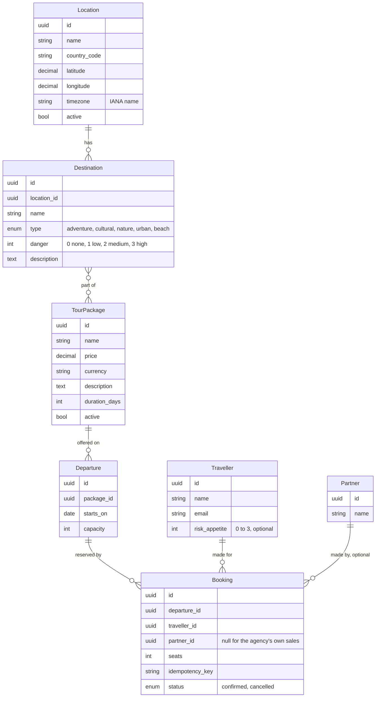

# 03 Data model

Status: draft, 2026-10-26.

## Entities

## Weather samples

Weather is not part of the catalogue, but what the worker fetches for known locations is kept
(ADR 0012): `WeatherSample(location_id, slot_time timestamptz, kind forecast|observation,
fetched_at, temp, temp_min, temp_max, condition_code, condition_label, pop, raw jsonb)`,
unique on (location_id, slot_time, kind), upserted on every fetch so the newest forecast wins
and an observation supersedes the forecast of its hour. Pruned after 90 days. Ad hoc
coordinates are served from Redis only. All timestamps are UTC; local days are computed with
the location's IANA zone (ADR 0013).

## Derived values

- Departure end date = starts_on + duration_days - 1; reported as `ends_on`, not stored (ADR 0011).
- Package danger = max(danger) over its destinations. Computed in the query with an
  annotation; not stored (ADR 0003).
- Remaining seats = capacity minus sum(seats) of confirmed bookings. Computed in the query;
  the booking write takes a row lock on the departure (ADR 0002).
- Package suitability for a traveller = package danger <= traveller risk appetite (extra feature).

## Constraints

- Departure: unique (package_id, starts_on); capacity > 0.
- TourPackage: duration_days >= 1.
- Booking: seats > 0; unique idempotency_key per traveller; a `partner` user's bookings carry
  its partner_id and are the only ones it can read.
- Location: unique (name, country_code); latitude in [-90, 90], longitude in [-180, 180];
  timezone must be a valid IANA name.
- WeatherSample: unique (location_id, slot_time, kind).
- Destination danger in [0, 3].

## Indexes

- Departure (starts_on) for the date range filter.
- Booking (departure_id, status) for the remaining seats aggregate.
- Destination (location_id); the package to destination join table on both keys.
- WeatherSample (location_id, slot_time) for the daily summary read.

## Seed data

Capitals of South America: Buenos Aires, Sucre (and La Paz as seat of government), Brasília,
Santiago, Bogotá, Quito, Georgetown, Asunción, Lima, Paramaribo, Montevideo, Caracas, plus
Cayenne for French Guiana. A handful of destinations and three packages with departures across
the next ninety days, so that the bookable query has something to return on first run.

## Audit and soft delete

Catalogue tables and Departure carry `created_at`, `updated_at`, `deleted_at` and an audit
row per change (actor, table, row, diff). Bookings are never deleted; they are cancelled.
