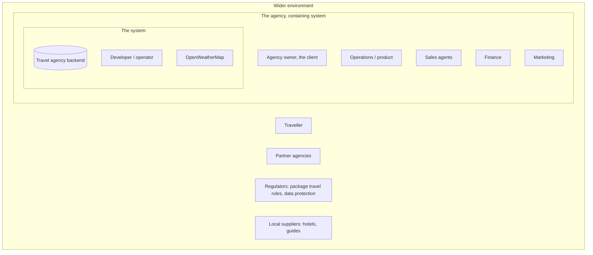

# 00 Domain: stakeholders, actors, language

Status: draft, 2026-10-26.

This file was written before the architecture. The brief names only "the client" and "the
agency". Everyone else who touches or depends on the system is defined here.

## 1. Stakeholder map (onion)

## 2. Stakeholders (arc42 1.3)

The table lists each stakeholder, how they reach the system, what they expect, and whether
they act on the system directly (an "actor").

| Role | Channel | Expectations | Actor |
|---|---|---|---|
| Agency owner ("the client" in the brief) | commissions the work, reads reports | A system that runs the agency (see below) | no |
| Operations / product | admin and API, daily | Manage the catalogue and capacity without developer help (see below) | yes: `ops` |
| Sales agents | API via the agency's front end | Find bookable packages, book without overbooking, cancel (see below) | yes: `sales` |
| Finance | read access | Bookings and prices per departure, exportable | yes: `finance` |
| Marketing | read access, weather data | Which destinations are warm this week; weather driven offers | reads through `finance` or `ops` |
| Partner agencies | API with their own token | Search and book for their travellers (see below) | yes: `partner` |
| Traveller | through the agency or a partner, never the API | A fitting tour and a confirmed seat (see below) | no (data subject; self-service in the roadmap) |
| Regulators | none, indirect | EU package travel rules and GDPR (see below) | no |
| Local suppliers | none in this iteration | Capacity per departure reflects what they can deliver | no |
| Case study visitor (reviewer) | the public site | Read the documents, try the live demo, see real data (see below) | yes: the site's embedded `demo` partner token |
| Developer / operator | repo, cluster | Easy to run, deploy and observe (see below) | yes: operates |
| OpenWeatherMap | HTTPS, API key | Stay inside the free tier's limits | external system |

- **Agency owner:** catalogue, dates, capacity, weather for sales. The system must be reliable
  and cheap to operate.
- **Operations / product:** manage locations, destinations, packages, departures and capacity
  without developer help. See what is sold out.
- **Sales agents:** find bookable packages for a traveller's dates and risk appetite. Book
  without overbooking. Cancel.
- **Partner agencies:** search and book on behalf of their travellers. They need a stable,
  documented contract.
- **Traveller:** a tour that fits their dates and risk appetite, and a confirmed seat. Their
  personal data is handled lawfully.
- **Regulators:** EU package travel rules (price transparency, cancellation rights), and GDPR
  for traveller data.
- **Case study visitor (reviewer):** read the documents, try the live demo without setup, and
  see real data.
- **Developer / operator:** one command locally, one pipeline to deploy, visible health, and
  documented decisions.

## 3. Jobs to be done, per actor

Each job is written as the actor would say it.

- **Operations:**
  - "When a supplier confirms a new date, I add a departure with its capacity, so sales can
    sell it the same day."
  - "When a trail is closed, I raise the destination's danger and every package containing it
    reflects it at once."
  - "Each morning I see which departures in the next 30 days are sold out or nearly sold out."
- **Sales:**
  - "When a traveller says 'first half of March, nothing too risky', I get the packages that
    depart in that window with danger at most medium and seats left."
  - "When two of us sell the last seat at the same time, only one booking goes through."
  - "When a traveller cancels, the seat is free again and the record stays."
- **Partner:**
  - "I integrate once against a documented API and the contract does not change under me."
  - "My bookings are mine; I never see another partner's."
- **Finance:** "At month end I list confirmed bookings with price and departure."
- **Marketing:** "This week I want the destinations above 25 °C to build an offer."
- **Operator:** "A bad deploy rolls back in one command; a lost server is rebuilt from code
  and the last backup."

Each job maps to an endpoint in [04-api.md](04-api.md) or to an extra feature. Extras are
proposed only where a job above asks for them.

## 4. Ubiquitous language

The ubiquitous language is the shared set of terms that the agency, the documents and the code
all use with one meaning.

| Term | Meaning here | Not to be confused with |
|---|---|---|
| Client | The agency owner, who commissioned the system (the brief's usage) | API clients, travellers |
| Traveller | The person who takes the tour; a record, not a user of the API | "customer", avoided as ambiguous |
| Location | A place on the map with coordinates and a time zone; the weather is read for it | destination |
| Destination | A sellable experience at a location, with a type and a danger score | location |
| Package | A named, priced tour made of destinations, with a duration | departure |
| Departure | One package on one start date with its capacity; the unit that is sold | package |
| Booking | Seats reserved on a departure for a traveller | enquiry |
| Danger score | 0 none, 1 low, 2 medium, 3 high; a package's score is the max of its destinations | risk appetite |
| Risk appetite | The highest danger a traveller accepts, on the same scale | danger score |
| Bracket | A temperature range used to group locations | forecast day |
| Bookable | Departure in the requested range, in the future, with seats remaining | active |

## 5. Roles and permissions

| Action | ops | sales | partner | finance |
|---|---|---|---|---|
| Read weather, brackets, locations, catalogue, departures | yes | yes | yes | yes |
| Create, update, delete locations, destinations, packages, departures | yes | no | no | no |
| Trigger a weather refresh | yes | no | no | no |
| Create a booking | yes | yes | yes (own travellers) | no |
| Cancel a booking | yes | yes | yes (own) | no |
| Read bookings | all | all | own only | all |
| Django admin | yes | no | no | no |

How tokens and roles work:

- Tokens identify a user. A user belongs to one role.
- A partner token is scoped to that partner's bookings.
- The case study site embeds the token of a `demo` partner. Visitors search and book as that
  partner only. Their bookings are visible as demo data, and a nightly job resets them (A17).
- The traveller has no token in this iteration (see 07-roadmap.md, self-service).

## 6. Domain events

A domain event is a named fact about something that happened in the business. These are named
now and published later (ADR 0008):

- `DepartureCreated`
- `DepartureSoldOut`
- `BookingConfirmed`
- `BookingCancelled`
- `DestinationDangerChanged`
- `WeatherRefreshed`

## 7. Questions I would ask the client first

Until the client answers, the system is built on the working assumption. The last column names
what would change if the answer differs.

| Question | Working assumption until answered | Would change |
|---|---|---|
| Who uses the system day to day, and do travellers book themselves? | Staff and partners; travellers through them | A8; roles §5 |
| How many packages, departures and bookings per year? | Hundreds of departures, thousands of bookings: PostgreSQL without partitioning | P5.7 targets |
| How many locations will the list grow to? | Tens; beyond that, the refresh budget adapts by lengthening the interval | W4.2 |
| How fresh must weather be for sales conversations? | 15 minutes for known locations | ADR 0005 |
| "Between two dates": the departure, or the whole trip? | The departure | A10, ADR 0011 |
| "For a given danger score": exactly, or at most? | At most, exact as a flag | A1, ADR 0003 |
| Which "today" decides bookability, and is a tour departing today still bookable? | The agency's time zone; yes, no cut-off | A16; roadmap (cut-off) |
| Cancellation and refund rules? | Cancellation frees the seat and keeps the record; fees and refunds out of scope | P6.5; roadmap |
| Which currencies, and is the price per person? | One per package, EUR default; per traveller | A7, A15 |
| Do partners need their own prices or quotas? | No; same catalogue, own bookings only | §5; roadmap (pricing) |
| Should travellers be told when a destination's danger rises or a departure is cancelled? | Not yet; the change is recorded and visible to sales | P2.2, P3.4; roadmap |
