# 02 Architecture

Status: draft, 2026-10-26.

The structure follows arc42 (docs.arc42.org), subsection by subsection. arc42 is a standard
template for architecture documents. The diagrams follow C4, a notation that zooms in step by
step, from the system in its context down to its parts. Open items are marked `TODO` and
tracked in [arc42-checklist.md](arc42-checklist.md).

## 0. Summary (one page)

**What it does, and for whom.** This is a backend for a travel agency. It offers:

- live weather, for any coordinates and for the agency's own locations;
- those locations grouped by temperature bracket;
- a product catalogue of packages, destinations and dated departures with capacity;
- a search over that catalogue by date range and danger score;
- bookings that never oversell.

Operations manage the catalogue. Sales and partner agencies search and book. Finance reads.
Travellers are served through these groups and never call the API (00-domain).

It runs as a Django + DRF (Django REST Framework) API with Celery workers (background job
processes), PostgreSQL and Redis. It is packaged as one Helm chart (a versioned package of
Kubernetes deployment files) on Kubernetes. A Next.js case study site sits in front.
The requirements are in 01-requirements, together with the seventeen assumptions that close
the brief's gaps.

**Structure.** Four Django apps sit behind one API:

- `weather`: the upstream adapter, samples, daily summaries.
- `locations`: the list, the seed, brackets.
- `catalog`: destinations, packages.
- `booking`: departures, bookings, the bookable search.

`core` carries the shared parts: token auth with the four roles, problem-detail errors,
trigger-based change history and health. A worker and a scheduler sit beside the API. The
container diagram is in §5.1.

**Two data flows.** Weather comes in on a schedule. The worker fetches every known location
from OpenWeatherMap, and fetches a new location at once. It upserts (inserts or updates) the
slots and observations into PostgreSQL. The API computes daily summaries from there. Ad hoc
coordinates are fetched on request and cached briefly in Redis.

The bookable search goes out from one query. It takes active packages whose derived danger
fits. It joins them to planned departures in the date range that have seats left. The result
is ordered and paged, and each entry carries its end date and remaining seats (§6).

**Three main decisions.**

- **The departure is the sellable unit.** A departure is package + date + capacity. A booking
  takes a row lock on it (a database lock that makes a second writer wait). So two sales of
  the last seat cannot both succeed (ADR 0002). The alternative was capacity on the package,
  but that could not express a sold out date.
- **Package danger is derived, never stored.** The query computes it from the package's
  destinations, so a changed trail is reflected at once (ADR 0003). A stored column is the
  documented next step if measured cost asks for it.
- **Known locations are never fetched on the request path.** A scheduled job writes to
  PostgreSQL inside the upstream's budget, and the API reads from there. A stale fallback and
  a circuit breaker back this up (ADR 0005, 0012). A circuit breaker stops calls to a failing
  service for a while, then tries again. The alternative was calling upstream per request,
  which breaks under the free tier's limits and outages.

**Quality order and limits.** The quality goals in priority order (§1.2):

- reliability toward the upstream first;
- then correctness of capacity and danger;
- then operability;
- then maintainability.

This iteration has clear limits: one server, no high availability, no event streaming, no
payments and no traveller self-service. Each one is in 07-roadmap, with what it would take.

**Stack and why.**

| Element | Role | Decision |
|---|---|---|
| Python, Django, DRF | API, admin for operations, ORM, migrations, OpenAPI | ADR 0001 |
| Celery (+ beat) | Scheduled and on-create weather refresh | ADR 0005 |
| PostgreSQL (CloudNativePG) | Catalogue, departures, bookings, weather samples, history tables | ADR 0007, 0012, 0014 |
| Redis | Ad hoc weather cache, Celery broker | ADR 0005 |
| OpenWeatherMap, free tier | Current weather and 3 hour forecast slots; the only external data source | F1 to F3 |
| Helm on k3s (Hetzner ARM), Terraform, ingress-nginx, cert-manager | One chart, with values per environment including an Azure (AKS) profile; HTTPS | ADR 0006, 0009 |
| Next.js | Case study site: demo, docs, operations, walkthrough | 05-work-packages W |

Everything below is the long form, in the sections of arc42 (a standard architecture
template). The decisions are in
[adr/](adr/README.md).

## 1. Introduction and goals

### 1.1 Requirements overview

This is a travel agency backend. It provides:

- weather for coordinates and for the agency's locations (grouped by temperature bracket);
- the product catalogue (packages, destinations, dated departures with capacity);
- a bookable-packages search by date range and danger score;
- bookings that never oversell.

Driving forces (00-domain):

- The agency owner wants to run the agency without developer help for everyday changes.
- Sales wants to answer "these dates, nothing too risky" in one query, and to book without
  double selling.
- Marketing wants weather it can sell with.
- Partner agencies want a contract they can integrate against once.

Requirements and their acceptance checks are in [01-requirements.md](01-requirements.md):

- W1 to W4: weather.
- L1 to L4: locations and brackets.
- P1 to P6: catalogue, departures and booking.
- N1 to N6: qualities.
- F1 to F5: facts about the environment.
- A1 to A16: assumptions that close the brief's gaps.

### 1.2 Quality goals

These are the top goals in priority order. Each is named after an ISO 25010 characteristic
(ISO 25010 is the standard model of software quality). Each goal also names what measures it:
quality scenarios in §10.2, requirements in 01.

| # | Goal | ISO 25010 | Meaning here | Measured by |
|---|---|---|---|---|
| 1 | Reliability toward the upstream | reliability: fault tolerance, availability | Answers even when OpenWeatherMap is slow, down or rate limiting. Its budget is never exceeded | Q1, Q2; W1.4, W1.5, W4 |
| 2 | Correctness of the product model | functional suitability: correctness | Capacity, availability and danger are never ambiguous or stale | Q3; P3, P4, P5, P6 |
| 3 | Operability: deploy, recover, observe | reliability: recoverability; maintainability: modifiability | Easy to run, deploy, roll back, restore and watch | Q4, Q5; N5 |
| 4 | Security | security: confidentiality, integrity, accountability | Controlled access, isolated partners, attributed changes | N6; W4.3; 00-domain §5 |
| 5 | Maintainability | maintainability: modularity, testability, analysability | Clear structure, tested, documented | Q6, Q7; N3.3 |

What "meaning here" covers in detail:

- **3 Operability:** one command locally; one pipeline to deploy; rollback in one command;
  restorable from backup; visible health and budget.
- **4 Security:** a token per user, with four roles; partners see only their own data; no
  secrets in git; callers are rate limited; every change is attributed.
- **5 Maintainability:** thin views; services per app; tests at the seams; lint and types
  clean; documented decisions.

### 1.3 Stakeholders

Stakeholders are defined in [00-domain.md](00-domain.md) section 2 (role, channel,
expectations, actor). In short:

- The agency owner commissions and reads.
- Operations, sales, finance and partner agencies are the actors (roles `ops`, `sales`,
  `finance`, `partner`).
- Travellers are data subjects, not users, in this iteration.
- Regulators and suppliers are indirect.
- The operator and OpenWeatherMap sit inside the system boundary.

The expectations that shaped the architecture most, and what answers each:

- **Operations:** change the catalogue, dates and capacity without a developer. Answered by
  the Django admin and the `ops` role (ADR 0001).
- **Sales:** one query for "these dates, at most this danger", and no double selling.
  Answered by the bookable search (P5) and the row lock on the departure (ADR 0002).
- **Partner agencies:** a stable, documented contract, and isolation from each other.
  Answered by the OpenAPI schema, the versioned path and partner-scoped bookings (04-api,
  00-domain §5).
- **Finance and regulators:** who changed what, when, and what a record looked like.
  Answered by trigger-based history (ADR 0014).
- **Operator:** reproducible from code, one command to deploy or roll back, health and budget
  visible. Answered by Terraform, Helm, CI and the operations status (ADR 0006, 0009).

## 2. Constraints

This section lists what was imposed on the design, and by whom. For each constraint it states
how the design complies or deviates.

| Group | Constraint | Source | How we comply or deviate |
|---|---|---|---|
| Given by the brief | Python, Django, PostgreSQL, Redis | the brief's stack | Complied. DRF and Celery are our additions on top (ADR 0001, 0005) |
| Given by the brief | Cloud: "Azure or AWS" | the brief's stack | **Deviates for the demo**: k3s on a Hetzner server (ADR 0006) |
| Given by the brief | Weather from OpenWeatherMap, free tier only | the brief | Complied. It shapes W3, W4 and ADR 0005, 0012 |
| Environment | Upstream data shape, limits, unreliability, time zone rules, uncontrolled callers | F1 to F5 in 01-requirements | Scheduled refresh into PostgreSQL, budget split, circuit breaker, IANA zones, per-caller limits |
| Organisational, budget | Short fixed time box, one developer, low monthly cost | project setting | Scope cut by work packages (05); single-node risks named |
| Legal | Traveller personal data (name, email) falls under GDPR | 00-domain §2 (regulators) | Only name and email kept; no card or payment fields |
| Self-imposed | Portability | ADR 0006 | One Helm chart, values per environment (Hetzner, local kind, AKS) |
| Conventions | Shared rules for documents and code | AGENTS.md, 01 §2, 03 | Checked in review and CI |

Details by row:

- **Cloud:** k3s (a lightweight Kubernetes distribution) runs on a Hetzner server, for cost
  and portability. An AKS values profile is kept and documented. The application has no
  provider-specific dependency (ADR 0006).
- **Organisational, budget:** the full set is a short fixed time box; one developer; one
  environment (no staging); no on-call; low monthly cost (one small server, free tiers). Scope
  is cut by work packages (05). The risks of a single node are named in §11 and the roadmap.
- **Legal:** the GDPR duties are to minimise, protect, and be able to erase. No payment data
  is ever stored. How we comply: only name and email are kept; there are no card or payment
  fields; access is by role; history tables carry data changes; an erasure flow is in the
  roadmap.
- **Self-imposed:** portability means the application depends only on PostgreSQL, Redis, S3
  compatible storage and OpenTelemetry.
- **Conventions:** the full list is:
  - English;
  - requirements in the ISO 29148 form with acceptance checks;
  - one MADR (Markdown Architecture Decision Record) per decision, with an Addresses line;
  - arc42 + C4 for architecture;
  - a data model standards table (03);
  - code files under 200 lines, documents exempt;
  - ruff, mypy, pytest;
  - Next.js App Router with shadcn/ui;
  - no secrets in git;
  - no AI attribution in commits.

Degrees of freedom: the brief fixes the framework and the data stores. These were free: the
cloud provider, the Kubernetes distribution, the libraries inside the stack and the
deployment topology. The choices are argued in ADR 0005 to 0009 and 0014.

## 3. Context and scope

### 3.1 Business context

This is the C4 context view: the system and everyone who talks to it. It is drawn as a plain
flowchart, so that every Markdown renderer shows it (ADR 0010).

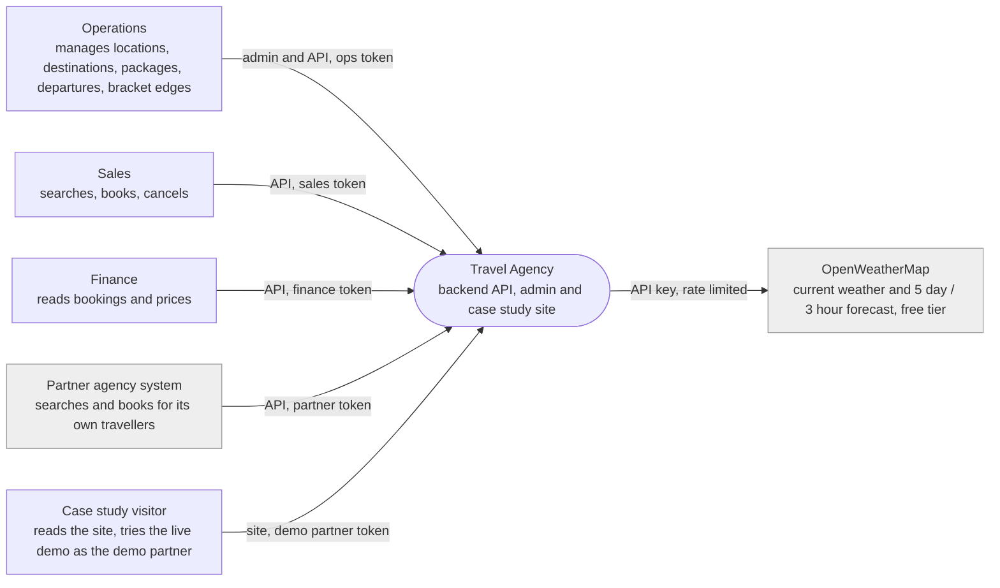

| Communication partner | Into the system | Out of the system |
|---|---|---|
| Operations | Locations, destinations, types, packages, departures, capacity, bracket edges, refresh trigger | Admin views, sold-out and remaining seats, refresh and budget status |
| Sales | Search criteria (dates, danger or traveller, type, price, weather), bookings, cancellations | Bookable packages with matching departures, end dates and seats; booking confirmations and conflicts |
| Finance | Date ranges | Bookings with price at booking, departure and status; history "as of" |
| Marketing (no role of its own) | reads with an ops or finance token | Brackets, forecasts, the weather aware filter |
| Partner agency system | Search criteria, bookings and cancellations for its own travellers | Same as sales, scoped to its own bookings |
| Case study visitor | Site navigation; demo searches and bookings under the demo partner | The site, the API docs, demo results (A17) |
| Traveller | nothing directly | nothing directly; served through sales or a partner (00-domain) |
| OpenWeatherMap | Current observation, 40 three hour forecast slots | Coordinates and the API key |

- **Case study visitor:** demo data is isolated and reset nightly (A17).

Formats:

- dates: ISO 8601;
- money: `numeric` + ISO 4217;
- countries: ISO 3166-1 alpha-2;
- zones: IANA names;
- coordinates: decimal degrees (WGS 84);
- errors: RFC 7807 problem details.

### 3.2 Technical context

| Channel | Protocol | Business partners | Carries |
|---|---|---|---|
| Public API `/api/v1` | HTTPS, JSON, `Authorization: Token` | operations, sales, finance, partners | Every business input and output above |
| Browser to site to API | Site proxy route, then the API with the demo partner token (ADR 0015) | case study visitor | Demo searches and bookings, operations status |
| Django admin | HTTPS, session cookie | operations | Catalogue edits (same data as the API) |
| Upstream weather | HTTPS, API key in query, JSON | OpenWeatherMap | Coordinates out; observations and forecast slots in |
| Task queue | Redis protocol, Celery | internal | Refresh jobs (scheduled, on create, manual) |
| Cluster internal | PostgreSQL wire protocol, Redis protocol; no TLS | internal | Persistence, cache, queue |
| Backups | S3 API over HTTPS | Hetzner Object Storage | PostgreSQL base backups and WAL |
| Certificates | ACME HTTP-01 over HTTPS (cert-manager) | Let's Encrypt | Certificate issue and renewal |
| DNS | A record, DNS only, no proxy | Cloudflare DNS | Name to server address |
| Infrastructure | Hetzner Cloud API over HTTPS (Terraform) | Hetzner | Server, firewall, volume, network |
| Delivery | HTTPS to ghcr.io; Kubernetes API over HTTPS with a deploy kubeconfig | GitHub Actions | Images and Helm releases |

Details by row:

- **Public API:** the OpenAPI 3 schema is at `/api/schema`, and Swagger at `/api/docs`.
- **Browser to site to API:** the site's pages call the site's own proxy route. The site's
  server then calls the API with the demo partner token (ADR 0015).
- **Cluster internal:** there is no TLS on a single node. Revisit this with a second node.
- **Backups:** WAL (write-ahead log) is PostgreSQL's running log of changes.
- **Certificates:** ACME is the protocol Let's Encrypt uses to issue certificates
  automatically.

## 4. Solution strategy

The strategies below answer the quality goals of §1.2, in their order, and the driving forces
of §1.1. Each one points at the decision that argues it.

| Goal or concern | Strategy | Decided in |
|---|---|---|
| 1 Reliability toward the upstream | Known locations are never fetched on the request path; degrade honestly; bulkhead | ADR 0005, 0012; W1, W2, W4 |
| 2 Correctness of the product model | The departure is the sellable unit; derived values are computed, not stored | ADR 0002, 0003, 0011, 0013; P3 to P6, A13 |
| 3 Operability | Everything from code, one Helm chart, probes, status, backups | ADR 0006, 0007, 0009; N5 |
| 4 Security | One token and one role per user; partner isolation; attributed writes | ADR 0014; N6, A17; 00-domain §5 |
| 5 Maintainability | Four Django apps as bounded contexts; traceable code and documents | ADR 0001, 0010; N2, N3 |

Each strategy in detail:

- **Reliability toward the upstream:**
  - Known locations are never fetched on the request path. A scheduled job (and an immediate
    one on create) writes slots and observations to PostgreSQL inside a call budget. The API
    reads from there.
  - Ad hoc coordinates are fetched on miss and cached briefly in Redis.
  - Degrade honestly: stale values with their age, `partial` days with sample counts, and 503
    with Retry-After only when nothing is stored.
  - Bulkhead (keeping parts apart so one cannot starve another): the budget is split between
    the refresh and ad hoc calls. Callers are rate limited. A circuit breaker fails fast.
- **Correctness of the product model:**
  - The departure (package + date + capacity) is the sellable unit.
  - A booking takes a row lock on it and carries an idempotency key. The key lets a retried
    request return the first result instead of booking twice.
  - Derived values (package danger, remaining seats, end date) are computed in queries, not
    stored, so nothing goes stale.
  - Bookings keep price and danger as snapshots, so records stay immutable.
  - Local calendar days come from UTC storage and IANA zones.
- **Operability:**
  - Infrastructure from code (Terraform).
  - The application as one Helm chart, with values per environment.
  - CI builds multi-arch images and deploys on push.
  - Liveness and readiness probes.
  - An operations status with cache, refresh, budget and breaker state.
  - Operator-managed PostgreSQL with nightly backups and a rehearsed restore.
- **Security:**
  - One token per user, one role per user (`ops`, `sales`, `partner`, `finance`).
  - Partner data is isolated by scope. The live demo runs as a `demo` partner.
  - Secrets are injected at deploy time.
  - Every write is attributed in trigger-filled history tables.
  - Problem details never leak internals.
  - Non-root images; pinned and scanned dependencies.
- **Maintainability:**
  - Four Django apps as bounded contexts (`weather`, `locations`, `catalog`, `booking`), plus
    `core`. A bounded context is one area of the business with its own model.
  - Thin views, logic in per-app services, the upstream behind one adapter interface.
  - Table tests for the rules (summary, brackets), concurrency tests for booking.
  - Requirements with acceptance checks, and ADRs with Addresses lines, keep code and
    documents traceable.
  - Lint, types and tests gate every merge.

Decomposition: the four apps follow the four jobs in 00-domain §3 and the four requirement
groups (W, L, P, N). Each app owns its models, services and tests. Each can be split into its
own service later, the weather adapter first (07-roadmap).

Deliberately not done, and why:

- No event bus yet. Nothing needs fan-out, and the outbox path is designed in (ADR 0008).
- No stored derived columns. There is no measured cost yet (ADR 0003).
- No managed cloud services for the demo. The reasons are cost and portability, and an AKS
  profile is kept (ADR 0006).
- No traveller-facing role. The brief asks for a system that runs the agency (00-domain §2).

## 5. Building block view

### 5.1 Level 1: containers (C4 level 2)

This is the C4 container view: the separately running parts and how they talk. It is drawn as
a plain flowchart (ADR 0010).

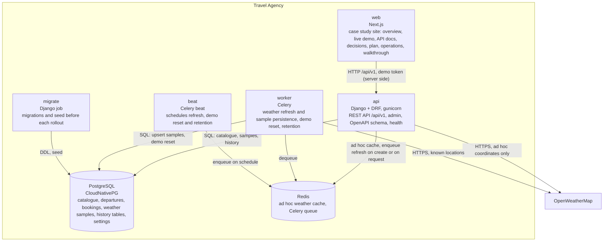

Black boxes (each container by what it does, not how):

| Container | Purpose | Interfaces | Fulfils | Location |
|---|---|---|---|---|
| api | Serves the public API and the admin | HTTPS in; SQL and Redis out; upstream HTTPS for ad hoc coordinates | W1, W2, L1 to L4, P1 to P6, N6 | `api/` |
| worker | Executes queued jobs | Redis queue in; upstream HTTPS and SQL out | W4, L1.5, A17, ADR 0012 | `api/` (same image, Celery entrypoint) |
| beat | Emits the schedule | Redis queue out | W4.2, 06-operations | `api/` (same image) |
| migrate | Applies migrations and the idempotent seed before the api rolls out | SQL | L2, Q4 | `api/` (same image, Helm pre-upgrade hook) |
| web | The case study site | HTTPS in; API out with the demo token | N1, N4 (demo), 08-walkthrough | `web/` |
| PostgreSQL | System of record | SQL; S3 for backups | N2, ADR 0007, 0012, 0014 | CloudNativePG cluster in `chart/` |
| Redis | Short lived cache for ad hoc coordinates; Celery queue | Redis protocol | ADR 0005 | `chart/` |

Details by row:

- **api:** it computes summaries, brackets and the bookable search at read time. Its HTTPS
  endpoints are `/api/v1`, `/admin`, `/healthz`, `/readyz` and `/metrics`.
- **worker:** its jobs are the scheduled and on-create refresh, the nightly demo reset and
  the 90 day sample retention. The refresh makes two upstream calls per location inside the
  budget, then upserts the samples.
- **beat:** it schedules the refresh every 15 minutes (the interval adapts to the budget), and
  the demo reset and retention nightly.
- **web:** it shows documents rendered from `docs/`, a live demo against the API, an
  operations page from `/ops/status`, and the walkthrough.
- **PostgreSQL:** it holds the catalogue, departures, bookings, travellers, partners, weather
  samples, settings and history tables.

### 5.2 Level 2: Django apps inside `api` (C4 level 3, to be verified against the code)

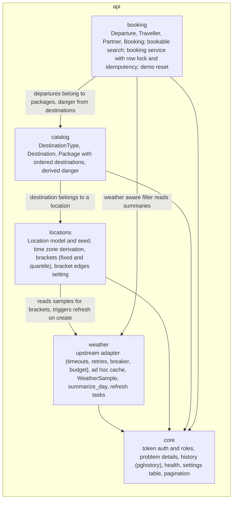

| App | Responsibility | Key modules | Fulfils | Depends on |
|---|---|---|---|---|
| core | Auth, errors, history, health, settings and shared helpers | `auth.py`, `errors.py`, `history.py`, `views.py` (health), `settings_store.py`, `redis_client.py` | N6, A16, ADR 0014 | Django, DRF, pghistory |
| weather | Upstream client, ad hoc cache, samples, daily summary, refresh tasks | `upstream/` (types, client, fixtures mock, budget, breaker, gateway), `domain/summary.py`, `samples.py`, `tasks.py`, `api/` (serializers, views, urls), `models.py` | W1 to W4, A11 to A14, ADR 0005, 0012, 0013 | core |
| locations | `Location`, seed, brackets endpoint, bracket edges endpoint | `models.py`, `seed.py`, `brackets.py`, `views.py` | L1 to L4, A4, A5, ADR 0004 | weather, core |
| catalog | `DestinationType`, `Destination`, `Package`, derived danger | `models.py`, `danger.py`, `views.py` | P1, P2, P4, A6, A7, A10, A15, ADR 0003, 0011 | locations, core |
| booking | `Departure`, `Traveller`, `Partner`, `Booking`; bookable search; booking service; departure cancel; demo reset | `models.py`, `search.py`, `service.py`, `views.py`, `tasks.py` | P3, P5, P6, N4, A1 to A3, A16, A17, ADR 0002 | catalog, weather, core |

Responsibility in detail:

- **core:**
  - auth: token, four roles, partner scope, demo partner;
  - the RFC 7807 handler;
  - history registration;
  - health endpoints;
  - settings (bracket edges, agency time zone);
  - the shared Redis connection;
  - shared pagination and test helpers.
- **weather:**
  - an upstream client with timeouts, retries, circuit breaker and budget split;
  - the ad hoc cache;
  - the `WeatherSample` upsert;
  - `summarize_day`: mean, min, max, daytime significant weather, local day by slot start;
  - refresh tasks (scheduled, on create, manual);
  - retention.
- **locations:**
  - `Location`: IANA zone, derived when omitted; active; soft delete; delete guard;
  - an idempotent seed of the thirteen capitals;
  - the brackets endpoint: half-open edges, no-data group, stale mark, quantile mode;
  - the bracket edges endpoint.
- **catalog:**
  - the `DestinationType` reference list;
  - `Destination`: danger 0 to 3, active, delete guard;
  - `Package`: price per traveller, duration, ordered destinations;
  - the derived danger annotation, with its label.
- **booking:**
  - `Departure`: status, capacity floor;
  - `Traveller`: risk appetite;
  - `Partner`;
  - `Booking`: seats, snapshots, idempotency key, cancelled_by;
  - the bookable search: validation, one query, stable order, extras;
  - the booking service (`select_for_update`);
  - departure cancel;
  - the demo reset task.

Dependency rule: arrows point one way (booking → catalog → locations → weather → core). No
app imports a dependent app. Review enforces this now; a lint rule will once the code exists.

## 6. Runtime view

### 6.1 Data flows

The first diagram shows how weather comes in and goes out.

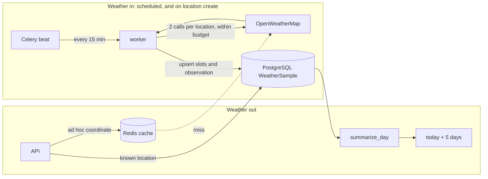

The ad hoc path also carries the stale fallback, the 503 when nothing is stored, and the
circuit breaker. R1 below shows them.

The second diagram shows the bookable search.

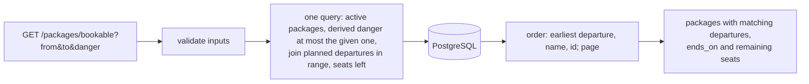

### 6.2 Scenarios (from the design; verify against the code)

These sequence diagrams cover the behaviours that the requirements pin down. Each one names
its acceptance checks, so a test can be written from it.

**R1 Current weather for an ad hoc coordinate** (W1.2, W1.4, W1.5, W4.6)

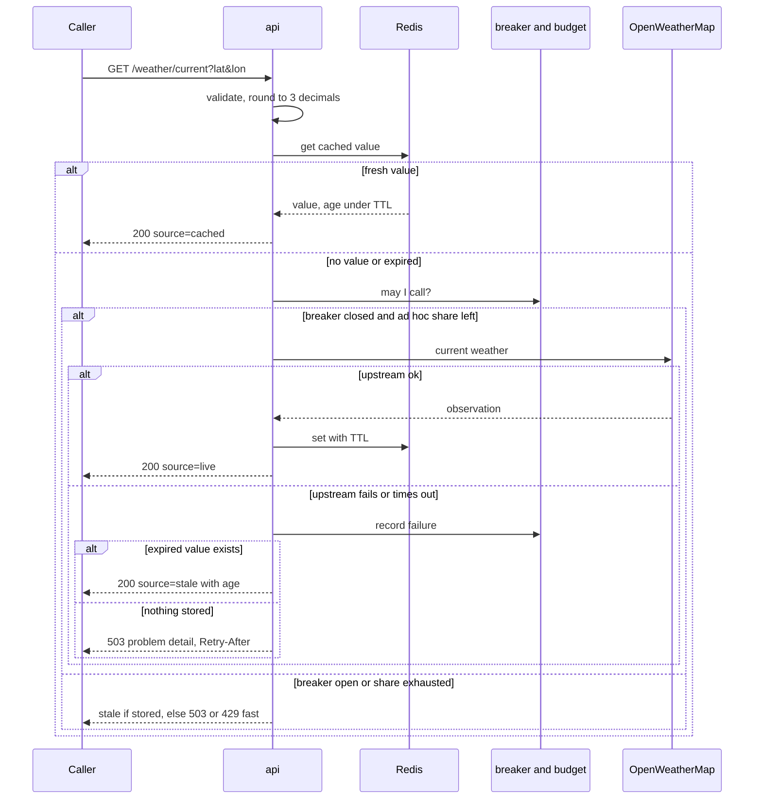

Known locations skip the upstream entirely. The API reads the latest observation from
`WeatherSample` (W1.1, W4.1).

**R2 Scheduled refresh with budget and partial failure** (W4.2, W4.4, L1.5, ADR 0012)

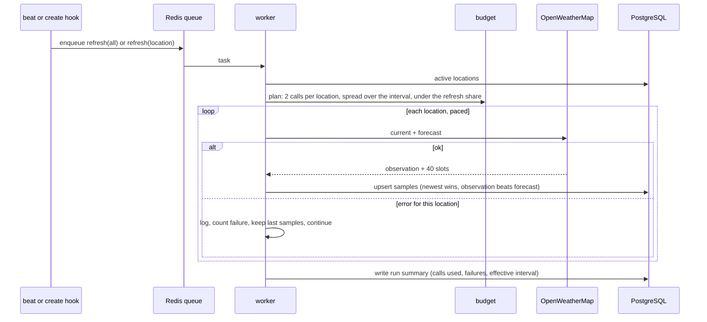

**R3 Bookable packages search** (P5): see the flow in 6.1. It is one query with validated
inputs and a stable order, and it returns only matching departures.

**R4 Two bookings for the last seat, and an idempotent retry** (P6.1 to P6.3, ADR 0002)

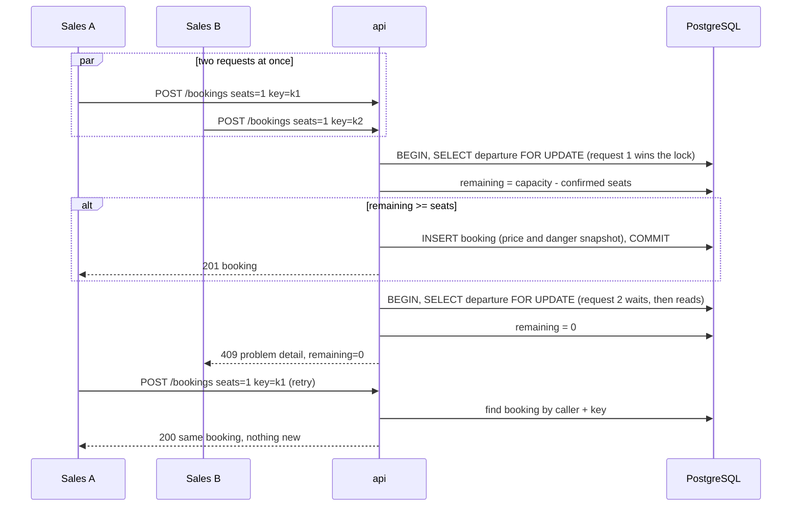

**R5 Operations creates a location** (L1.2, L1.5, L3.2)

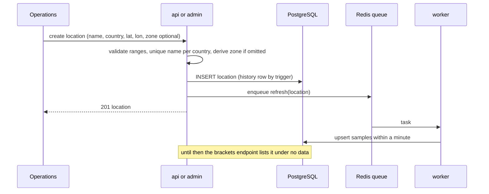

Not drawn, but covered by tests:

- departure cancel with bookings (P3.4);
- nightly demo reset and sample retention (06-operations);
- rolling deploy with the migrate job (Q4).

## 7. Deployment view

### 7.1 Infrastructure (level 1)

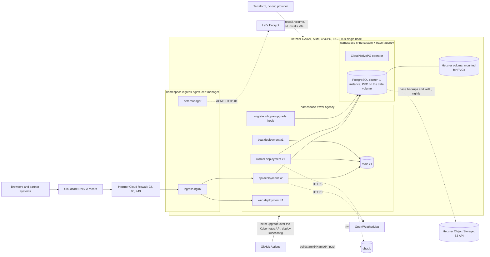

### 7.2 Mapping of building blocks to infrastructure

"Requests / limits" are the CPU and memory a container is guaranteed, and the most it may use.

| Building block | Runs as | Replicas | Requests / limits (start values) | Notes |
|---|---|---|---|---|
| api | Deployment, gunicorn, image `api` | 2 | 250m / 1 CPU, 384 / 768 MiB | Rolling update; readiness on `/readyz`, liveness on `/healthz` |
| worker | Deployment, Celery, image `api` | 1 | 100m / 500m, 256 / 512 MiB | Concurrency 2; `acks_late`, idempotent tasks |
| beat | Deployment, Celery beat, image `api` | 1 | 50m / 200m, 128 / 256 MiB | Exactly one; schedule in code |
| migrate | Job, image `api` | 1 per rollout | 100m / 500m, 256 / 512 MiB | Helm pre-upgrade hook: migrate + idempotent seed; the rollout waits for it |
| web | Deployment, Next.js, image `web` | 1 | 100m / 500m, 256 / 512 MiB | Static where possible; talks to the API with the demo token |
| PostgreSQL | CloudNativePG `Cluster`, 1 instance | 1 | 500m / 1 CPU, 1 / 1.5 GiB | PVC on the Hetzner volume; backups to Object Storage, 14 days; restore drill (N5.3) |
| Redis | Deployment, no persistence | 1 | 50m / 250m, 128 / 256 MiB | Cache and queue only; losing it loses nothing durable |
| ingress-nginx, cert-manager | Helm charts, own namespaces | 1 each | defaults | TLS termination, Let's Encrypt issuer |
| CloudNativePG operator | Helm chart, `cnpg-system` | 1 | defaults | Manages the cluster, backups, failover later |
| optional kube-prometheus-stack | Helm chart, `monitoring` | 1 | about 1 to 1.5 GiB | Only if the Operations page needs real metrics; fits, but last |

- **api:** readiness decides when a pod gets traffic; liveness decides when it is restarted.
  There are two replicas, so a rollout has no gap (Q4).
- **PostgreSQL:** a PVC (persistent volume claim) is the disk space a pod asks Kubernetes for.

Budget on the node: about 5 to 6 GiB of 8 GiB are in use with everything above except
monitoring. k3s itself takes under 1 GiB. CPU is not the constraint.

### 7.3 Node, network, storage, secrets

- **Node:** one Hetzner CAX21 (ARM64) running Ubuntu LTS.
  - cloud-init installs k3s with Traefik disabled (ingress-nginx instead).
  - k3s uses the embedded SQLite datastore (one node).
  - SSH is by key only.
- **Network:** the Hetzner Cloud firewall allows 22 (operator IPs), 80 and 443. Everything
  else is closed.
  - Inside the node, services talk over the cluster network without TLS (§3.2, revisit with a
    second node).
  - Egress: OpenWeatherMap, Let's Encrypt, ghcr.io, Object Storage.
- **Storage:** a separate Hetzner volume holds the PVC data (PostgreSQL). The OS disk holds
  images and k3s. Object Storage holds backups and WAL, with retention of 14 days.
- **Secrets:** Kubernetes Secrets in `travel-agency` hold the OpenWeatherMap key, the Django
  secret, the Redis password and the ghcr pull secret.
  - The operator creates the database credentials.
  - Nothing is in values files or git.
  - `make secrets` creates them from the operator's shell.
- **Images:** `ghcr.io/<owner>/travel-agency-api` and `-web`. Tags = commit SHA and
  `latest`. Built for arm64 + amd64 (ADR 0009).

### 7.4 Environments

| Environment | Where | Values file | Differences |
|---|---|---|---|
| local | kind on a laptop (arm64) | `values-local.yaml` | PostgreSQL and Redis in cluster via the same chart; no TLS; `localhost` ingress; seed plus demo data |
| hetzner | the node above | `values-hetzner.yaml` | This section; Let's Encrypt; backups on |
| azure (documented, not run) | AKS, amd64 pool | `values-azure.yaml` | Managed data stores, Azure ingress, workload identity; application unchanged (ADR 0006) |

- **azure:** Managed PostgreSQL and Azure Cache for Redis replace the in-cluster ones
  (CloudNativePG and the Redis deployment are disabled). It uses the Azure ingress class, and
  workload identity for secrets. The application is unchanged (ADR 0006).

### 7.5 Delivery

A push to `main` runs these steps in order:

- CI: ruff, mypy, pytest with PostgreSQL and Redis services.
- buildx builds images for arm64 and amd64, and pushes them with the SHA tag.
- `helm upgrade --install` runs against the cluster, with a deploy kubeconfig held as a
  GitHub secret.
- The migrate job runs.
- The api rolls out (two replicas, readiness gated).
- A smoke test runs on `/readyz` and one bookable query.

Rollback: `helm rollback`.

Decisions: ADR 0006, 0007, 0009. Runbook: 06-operations.

## 8. Cross cutting concepts

These concepts apply to several building blocks. They are grouped as arc42 suggests. Each row
names where the rule is decided.

### 8.1 Domain

| Concept | Rule | Decided in |
|---|---|---|
| Ubiquitous language | One meaning per business term, used in code, API and documents | 00-domain §4 |
| Aggregates | Departure + Booking is one consistency boundary (the row lock) | ADR 0002, 0012 |
| Derived, not stored | Derived values are computed at read time | ADR 0003, 0011, 0013; N2.2 |
| Lifecycle | Deactivate is different from delete; bookings and departures are cancelled, never deleted | L1.3, L1.4, P1.6, P2.5, P3.4 |
| Money | `numeric(12,2)` + ISO 4217 code, per traveller; never floats | A7, A15; 03 §Standards |
| Time | UTC in storage; IANA zone per location | ADR 0013; A13, A16; F4 |

- **Ubiquitous language:** a shared vocabulary for the business and the code. The terms are
  Client, Traveller, Location, Destination, Package, Departure, Booking, Danger score, Risk
  appetite, Bracket, Bookable.
- **Aggregates:** an aggregate is a group of records that always change together. Package +
  ordered destinations is another. Location + its samples is a third.
- **Derived, not stored:** package danger, remaining seats, end date, daily summaries and
  brackets are computed at read time. The only copies are the booking snapshots (price,
  danger), which keep records immutable.
- **Lifecycle:** deactivate means hidden from new use, with data kept. Delete is refused while
  the record is referenced; otherwise it is a soft delete.
- **Time:** the local calendar day is computed in code, and a slot is assigned by its start.
  "Today" for bookability is the agency's zone. tz data is kept current.

### 8.2 API and user interface

| Concept | Rule | Decided in |
|---|---|---|
| Contract | `/api/v1`, JSON, OpenAPI 3; breaking changes mean `/api/v2` | 04-api; 00-domain §3 (partners) |
| Errors | RFC 7807 problem details on every non-2xx | N6.4; W1.5; W4.3 |
| Validation | Two layers: database constraints (FK, UNIQUE, CHECK) and serializer validation that mirrors them | N2.1 |
| Pagination and order | Page size 20, stable order on every list (explicit tie breakers) | P5.5 |
| Filters | Extras only narrow a required result; absent parameters leave the required behaviour unchanged | P5.6; N4.5 |
| Honest degradation | The consumer sees data quality; nothing is hidden | W1, W2, L3; ISO 25012 |
| Admin | Django admin for `ops` only, same models and constraints as the API | ADR 0001 |
| Case study site | Reads `docs/` and the API; acts as the `demo` partner | A17; 04-api; ADR 0015 |

- **Contract:** the OpenAPI 3 schema is at `/api/schema`, and the Swagger UI at `/api/docs`.
- **Errors:** a problem detail is a standard JSON error body. Validation errors name the
  field. Internals are never echoed. 429 and 503 carry `Retry-After`.
- **Honest degradation:** the marks are `source` (live, cached, stale), `partial`, sample
  counts, `observed_at`, `as_of` and `stale`.
- **Case study site:** the demo token stays in the site's server. Requests are forwarded
  through an allow-listed proxy route.

### 8.3 Security

| Concept | Rule | Decided in |
|---|---|---|
| Identity and roles | Token per user, one role per user: `ops`, `sales`, `partner`, `finance` | 00-domain §5; N6.1 |
| Partner isolation | A partner token reads, writes and cancels only its own bookings; the demo partner is one of them | N6.2, N6.7; A17 |
| Secrets | Kubernetes Secrets injected at deploy time; none in git, values files or images | N5.4, N6.3; 06-operations |
| Rate limiting | Per-token limit on ad hoc weather requests | W4.3; ADR 0005 |
| Personal data | Traveller name and email only; no payment data | §2 Legal; 07-roadmap |
| Supply chain | Pinned dependencies, scanned in CI; non-root images; images by commit SHA | N6.6; ADR 0009 |

- **Identity and roles:** 401 without a token; 403 outside the role's permissions.
- **Secrets:** rotation = replace and restart.
- **Rate limiting:** the upstream budget is also split between refresh and ad hoc calls
  (bulkhead).
- **Personal data:** access is by role. Erasure is an operations task; self-service is in the
  roadmap.

### 8.4 Resilience and performance

| Concept | Rule | Decided in |
|---|---|---|
| Upstream adapter | One client behind an interface | ADR 0005; W4 |
| Caching | Redis, cache-aside with TTL (10 min), ad hoc only | ADR 0005 |
| Scheduled work | Celery with idempotent tasks (upserts) | W4.2, W4.4; R2 |
| Concurrency | `select_for_update` on the departure inside a transaction; idempotency keys per caller | ADR 0002; P6 |
| Query discipline | One query per list endpoint (no N+1), index per named query, plans documented | N3.1; N2.6; P5.7 |
| Retention | Weather samples 90 days; backups 14 days; demo bookings reset nightly; history tables unbounded in this iteration | ADR 0012; 06-operations |

- **Upstream adapter:** the client has:
  - timeouts;
  - bounded retries with backoff and jitter;
  - a circuit breaker (open after repeated failures, probe to close);
  - budget accounting per minute and month.
- **Caching:** cache-aside means the code checks the cache first and fills it on a miss. TTL
  is how long an entry lives.
  - Keys are coordinates rounded to 3 decimals.
  - Expired values are served as stale while a refresh is attempted.
  - There is no second copy for known locations.
- **Scheduled work:**
  - `acks_late`, so a task is only marked done after it finishes;
  - time limits;
  - calls spread over the interval;
  - the interval lengthens when the budget would be exceeded;
  - one location's failure never aborts the run.
- **Query discipline:** N+1 is the pattern of one extra query per row in a list.

### 8.5 Development

| Concept | Rule | Decided in |
|---|---|---|
| Structure | Four Django apps as bounded contexts plus `core`; one-way dependencies | §5.2; N3.3 |
| Testing | Rule, concurrency, query-count, upstream and schema tests | N3; N2.7; W3.5 |
| Tooling | ruff, mypy, pytest in CI gating merges; Next.js App Router with shadcn/ui; code files under 200 lines | AGENTS.md; N3.3 |
| Traceability | Requirement ids in tests and commits; ADRs with Addresses lines; arc42 checklist | 01 §2; ADR 0010 |
| Configuration | Environment variables only | §7.3; A16; L4 |

- **Structure:** thin views, logic in per-app `services`. Dependencies run one way (booking →
  catalog → locations → weather → core).
- **Testing:**
  - table tests for rules (daily summary, brackets);
  - a concurrency test for the last seat;
  - `assertNumQueries` on lists;
  - a mocked upstream plus one live smoke test;
  - a schema test against the data model.
- **Configuration:** `.env.example` documents the names. Settings that operations change
  (bracket edges, agency zone) live in a settings table.

### 8.6 Operations

| Concept | Rule | Decided in |
|---|---|---|
| Health | `/healthz` process, `/readyz` database and Redis | N3.2; §7.2 |
| Observability | Structured JSON logs, OpenTelemetry traces, Prometheus metrics, `/ops/status` | N5.5; 04-api |
| History | Per-table history tables filled by triggers with actor and request; "as of" reads for finance and audits | ADR 0014 |
| Backup and restore | Nightly base backup plus WAL to Object Storage; restore drill recorded with its duration | N5.3; ADR 0007 |
| Delivery | CI on every push to main; migrate job before rollout; rolling update with readiness gates; one-command rollback | §7.5; Q4 |
| Runbook | Deploy, rollback, secrets, backups, demo reset, tz data, what to look at first | 06-operations |

- **Health:** Kubernetes probes use both. Traffic arrives only after ready.
- **Observability:**
  - logs carry request id, user and partner;
  - Prometheus metrics (RED per endpoint, budget and breaker gauges) come when the monitoring
    stack is installed. RED means rate, errors and duration;
  - `/ops/status` serves the site.

## 9. Architecture decisions

There are fourteen decisions, all accepted 2026-10-27, in [adr/README.md](adr/README.md).
Here they are grouped by the quality goal they serve:

| Goal (§1.2) | Decisions |
|---|---|
| 1 Reliability toward the upstream | 0005 scheduled refresh into PostgreSQL, budget, breaker; 0012 persisted samples; 0013 daily summary and time rules |
| 2 Correctness of the product model | 0002 departure and row lock; 0003 danger scale and derivation; 0011 date range on the departure |
| 3 Operability | 0006 k3s on Hetzner with one chart; 0007 CloudNativePG; 0009 ghcr and multi-arch CI |
| 4 Security | 0014 history by triggers (accountability); roles and partner scope in 00-domain §5 |
| 5 Maintainability | 0001 Django and DRF; 0004 configurable brackets; 0008 no event streaming yet; 0010 arc42 and C4 |

## 10. Quality requirements

### 10.1 Quality tree

The tree runs from the goals of §1.2, through ISO 25010 sub-characteristics, to the scenarios
of §10.2 and the requirements that carry them.

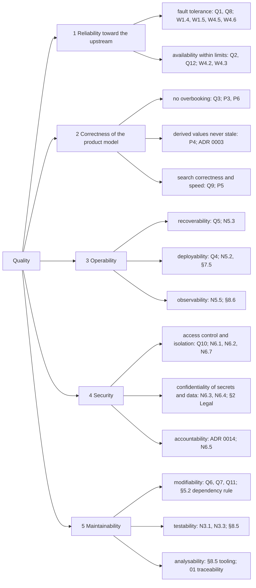

### 10.2 Quality scenarios

Each scenario is in short form: context, stimulus, response, metric. The type is one of:

- U = usage scenario;
- C = change scenario.

| Id | Type | Context | Stimulus | Response | Metric |
|---|---|---|---|---|---|
| Q1 | U | Normal load, samples present | OpenWeatherMap returns 5xx for 10 minutes | Weather endpoints answer from stored data, marked stale | 0 upstream-caused 5xx while stored values exist; p95 latency unchanged |
| Q2 | U | 13 locations, 15 minute refresh | A day of operation | Calls stay inside the refresh share; samples pruned at 90 days | under 5 calls/min of 60; monthly under 100k; table under 40k rows |
| Q3 | U | One seat left on a departure | Two bookings at the same moment | One 201, one 409 with remaining=0 | 0 overbookings in the concurrency test, 100 runs |
| Q4 | U | Live traffic | Deploy a new api version with a migration | Migrate job, then rolling update behind readiness | 0 failed requests during rollout |
| Q5 | U | Server lost | Rebuild from Terraform, Helm and the last backup | System back with yesterday's data | restore drill under 30 minutes; RPO one night |
| Q6 | C | Client decides danger means exact match | Change the default | One query change, tests updated, one ADR | under one hour |
| Q7 | C | A second weather provider is wanted | Add an adapter behind the same interface | Summaries and brackets unchanged | no change outside `weather` |
| Q8 | U | Normal refresh running | One caller sends 200 ad hoc coordinates a minute | Caller gets 429 with Retry-After past its limit; refresh share untouched | refresh calls unaffected; 0 upstream 429s |
| Q9 | U | 5,000 packages, 50,000 departures, 200,000 bookings | Bookable search over a 30 day range | One index-backed query, paged | p95 under 300 ms; plan documented |
| Q10 | U | Two partners with bookings | Partner A reads, changes or cancels B's booking | 403 or 404, never data | 0 cross-partner reads in the auth tests |
| Q11 | C | A fifth role (for example marketing with its own token) is wanted | Add the role and its permissions | Matrix updated in 00-domain and `core`, no view changes | under two hours |
| Q12 | U | Location list grows to 500 | Scheduled refresh | Interval lengthens automatically; status shows the effective interval | under 48 calls/min; no 429 from upstream |

- **Q1:** the refresh also backs off, and the breaker opens, then probes. p95 is the latency
  that 95 of 100 requests stay under.
- **Q5:** RPO (recovery point objective) is how much recent data a restore may lose.

## 11. Risks and technical debt

| Priority | Risk or debt | Consequence | Measure |
|---|---|---|---|
| 1 | Single node, single disk, single Celery beat | Outage on server loss until restored; no failover | Now: backups and a rehearsed restore (Q5). Roadmap: second node, PostgreSQL replica, beat on a lease |
| 2 | CloudNativePG learning curve inside a short time box | Days lost on the operator | Fallback rule in ADR 0007: plain chart if not clean by the first working day |
| 3 | Free tier weather data | No history, 3 hour resolution, 120 hour window, first-day partial today | Persisted samples (ADR 0012); `partial` stated; paid tier if the client needs more |
| 4 | Upstream API or condition codes change | Wrong labels or failed parsing | Closed label set with `unknown` fallback (W3.4); sample payloads in tests; adapter isolated (Q7) |
| 5 | Certificate issuance fails (ACME, DNS not yet propagated, Let's Encrypt rate limits) | Site unreachable over HTTPS on launch day | Staging issuer first, then production; DNS set a day ahead; runbook entry |
| 6 | Demo partner token is public by design | Demo data abuse, upstream budget pressure | Partner scope, per-token rate limit, nightly reset, ad hoc share cap (A17, W4.3) |
| 7 | History tables grow without bound | Disk use over years | Acceptable now; retention policy in the roadmap (GDPR row) |
| 8 | tz data goes stale in images | Local days mis-assigned after a DST rule change | tzdata updated on every image build (06-operations); F4 |
| 9 | Precipitation probability ignored in the daily label | A likely-rain day labelled clear | Deliberate (ADR 0013); roadmap item with a client-set threshold |
| 10 | One developer, no second reviewer | Blind spots in code and operations | ADRs and acceptance checks as the second reviewer; CI gates; walkthrough as review |

- **Risk 5:** the `.dev` zone is HSTS-preloaded, so browsers always force HTTPS for it. There
  is no HTTP-only fallback. The staging certificate is checked with `curl -k` before the
  production issuer is switched on.

## 12. Glossary

Business terms are defined once in [00-domain.md](00-domain.md) section 4. The table below
covers the technical terms used in this document.

| Term | Definition |
|---|---|
| Known location | A row in the location list. Refreshed by the worker, read from stored samples |
| Ad hoc coordinate | A latitude and longitude not in the list. Fetched on request, cached briefly, never persisted |
| Weather sample | One 3 hour forecast slot or one observation for a known location, stored in UTC. The newest fetch wins; an observation beats a forecast |
| Local day | The calendar day in the location's IANA zone. A slot belongs to the day in which it starts |
| Partial | A day whose slots are incomplete, reported with sample counts. Examples: today's past hours for ad hoc coordinates, the cut fifth day, a gap |
| Stale | A stored value served because the upstream could not be reached. It carries its age |
| Bracket edge | A number in the ascending edge list. Brackets are half-open, open ended at both ends |
| Departure | A package on one date with its capacity. It ends after the package's duration |
| Bookable | An active package with a danger score, and a planned departure starting in the range, on or after the agency's today, with seats remaining |
| Snapshot | A value copied onto a booking at booking time (price, danger), so the record stays immutable |
| History table | The per-table change log filled by database triggers with actor and request (ADR 0014) |
| Budget share | The part of the upstream's per-minute limit reserved for the scheduled refresh or for ad hoc calls |
| Circuit breaker | The adapter state that stops upstream calls after repeated failures and probes to resume |
| Demo partner | The `partner` user whose token the case study site embeds. Its bookings are isolated and reset nightly |
